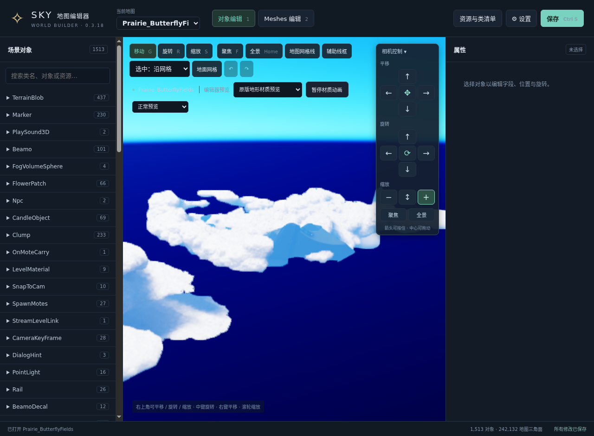
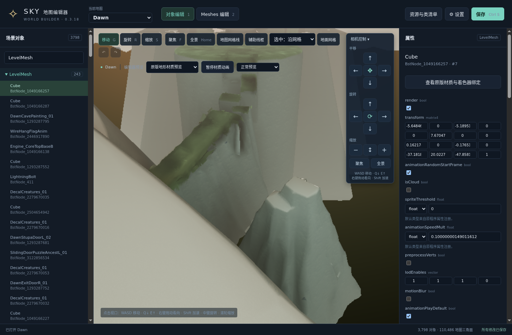
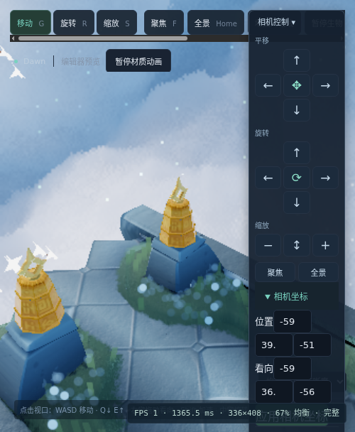

# Sky Map Editor · 光遇地图编辑器

Sky Map Editor 是一款面向 Windows 的《光遇》地图可视化查看与编辑工具。它读取使用者本地的 Sky `Data` 目录，在三维视口中展示地图、场景对象、模型、材质和环境效果，并提供属性编辑、空间变换、网格编辑与动画预览功能。

项目将地图数据查看、资源查询和场景编辑集中在一个桌面界面中，适合研究地图结构、调整场景布局、检查资源引用，以及学习游戏资源解析和三维渲染。

## 界面展示

以下为项目已有截图，界面与效果以实际运行版本为准。

**地图浏览：蝴蝶平原场景与对象分类。**



**对象属性：选中模型后查看变换与保存字段。**



**场景细节：建筑、材质与视角控制。**



## 可以做什么

- **浏览地图与资源**：选择本地地图，在三维场景中查看地形和模型；通过对象树、搜索和属性面板定位对象，查询模型、材质、着色器及类信息。
- **编辑场景对象**：查看和修改支持的对象字段，使用移动、旋转、缩放工具调整对象布局，预览修改后的场景。
- **编辑地图网格**：查看地形、裙边和烘焙数据，调整网格位置、材质 ID 与权重，进行裙边雕刻，并新增平面、立方体和球体等基础几何。
- **预览模型与生物**：查看模型动作，播放、暂停和还原动画；观察鸟群、遥鲲、螃蟹、冥龙、蝴蝶等生物的移动与姿态，以及冥龙巡视效果。
- **查看环境与交互效果**：预览天空、云雾、水面、材质动画和蜡烛点火效果；通过 Avatar 模式查看角色模型与场景。
- **保存地图修改**：将支持的对象和网格修改写回地图文件，提供撤销、重做和保存时的原文件备份。

对象编辑主要对应 `Objects.level.bin`，网格编辑主要对应 `BstBaked.meshes`。生物与环境预览包含编辑器适配，具体支持程度取决于资源格式和版本。

## 适合哪些用途

- **地图与场景研究**：了解地图由哪些对象、模型和材质构成，查看它们之间的资源引用和空间关系。
- **本地场景编辑**：调整对象位置、方向和尺寸，修改支持的地图参数，并直接查看编辑结果。
- **资源与动画检查**：观察模型外观、材质表现和动作，检查布局及资源加载情况。
- **学习与开发**：研究二进制地图解析、骨骼动画、Vulkan 渲染、资源管理和编辑器交互实现。

## 如何使用

使用 Windows 程序包时：

1. 完整解压程序包，运行 `SkyMapEditor.exe`。
2. 在设置中选择自己的 Sky `Data` 目录，然后选择地图。
3. 使用 **bin 编辑**查看和修改对象，使用 **meshes 编辑**处理网格，或进入 **Avatar 模式**查看角色。
4. 在对象列表或视口中选择目标，通过属性面板和变换工具编辑。
5. 按 `Ctrl + S` 保存。原文件备份位于对应地图的 `.sky-editor-backups` 目录。

程序和源码仓库均不附带原游戏 `Data`，地图功能需要使用者自行配置有权使用的资源。

### 常用操作

| 操作 | 按键或方式 |
| --- | --- |
| 移动视角 | `W / A / S / D` |
| 视角升降 | `Q / E` |
| 调整看向 | 按住右键拖动 |
| 加速移动 | `Shift` |
| 缩放视图 | 鼠标滚轮 |
| 移动、旋转、缩放对象 | `G / R / S` |
| 聚焦所选 / 查看全景 | `F / Home` |
| 保存 | `Ctrl + S` |
| 撤销 / 重做 | `Ctrl + Z / Ctrl + Shift + Z` |
| 切换编辑模式 | `1 / 2 / 3` |

## 从源码编译

项目使用 **TypeScript、Electron、Three.js 和 C++ / Vulkan**。当前 Windows x64 构建脚本通过 Ubuntu 或 WSL 中的交叉编译工具链生成原生渲染程序。

先按照 [纯净源码编译说明](docs/纯净源码编译说明.md) 安装 Node.js、Python、Vulkan 头文件、GLSL / SPIR-V 工具和 MinGW，再在 Ubuntu / WSL 中执行：

```bash
git clone https://github.com/XianXiaoWei/Sky_Map_Editor_0318.git
cd Sky_Map_Editor_0318
npm ci
npm run build:windows
```

构建产物位于 `dist/`。编译程序本身不需要 Data；生成地图视口着色器和使用地图功能时需要配置外部资源。Windows 部署还需搭配 Windows Electron 运行时，详细步骤见编译说明。

## 仓库结构

| 目录 | 内容 |
| --- | --- |
| `src/core/` | 地图与资源解析、数据编辑和行为计算 |
| `src/main/` | 桌面主进程、资源访问和 Vulkan 渲染接口 |
| `src/renderer/` | 编辑器界面、三维交互和预览控制 |
| `native/` | C++ Vulkan 渲染程序与内置着色器源码 |
| `tools/` | 构建、打包、资源检查和研究工具 |
| `tests/` | 回归测试及数值样例 |
| `docs/`、`evidence/` | 使用说明、技术资料与研究记录 |

仓库提供源码、测试和必要的静态参数，不包含 Data、原游戏程序、依赖安装目录或编译产物。大报告的解压方式和研究工具所需的外部输入见 [GitHub 源码说明](docs/GitHub源码说明.md)。

## 作者、许可与反馈

作者：[县小威 · XianXiaoWei](https://github.com/XianXiaoWei)。

本项目采用 [禁止商用版权许可](LICENSE.md)，供学习、研究和非商业交流使用。使用、修改或传播时须保留作者署名和许可文件；商业使用须取得相应著作权人的另行书面许可。

本项目为独立研究与编辑工具，原游戏资源和第三方依赖的权利归各自权利人所有，详见 [GitHub 项目声明](GitHub声明.md)。

问题、建议或授权咨询，请自行发送邮件至 **3661380498@qq.com**。反馈问题时，请附上软件版本、操作系统、地图名称、复现步骤及错误信息。
