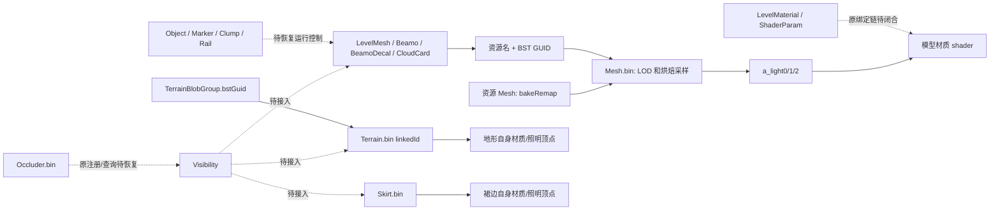

# BstBaked.meshes 当前五个数据段清单与进度

已验证检查项 / 每段明确列出的 10 项。本表是阶段清单进度，不是全部原函数、工作量或原游戏还原比例；未恢复项不记分。原函数依赖尚未闭合，完整还原百分比保持 null。

当前输入是 Sky 0.3.18 的 33 张地图：1 张 v51、32 张 v52。Mesh/Terrain/Cloud/Skirt/Occluder 是解压 LOD0 内连续的五个逻辑区域；`.bin` 为讨论/拆分名称，当前 TOC 实际为 LOD0。五段合计 189,997,299 字节，逐地图无空隙/重叠/尾部未解析字节。

Objects.level.bin 第一；BstBaked.meshes 和 Avatar 模式第二。先逆向原加载、创建、注册、更新和销毁整体调用链，再按原依赖从基础类向功能类推进。引用到未实现的玩法、交互、UI、贴图、音频、shader、BstBaked 或 Avatar 功能时一同恢复。最终目标为原游戏逻辑 100% 还原；五个 BstBaked 段仍以各 9/10 为真机验收前阶段目标，最后一项为真机与原游戏校验。 新完成的 [Visibility 生命周期与地形候选](Visibility生命周期与地形候选.md)包含 227 组完整方法序列、全部 33 地图遮挡输入和 3,044 组原 OBB 检查；未完成整项前不提升分数。

| 数据段 | 清单进度 | 实际数据 | 主要缺口 |
| --- | --- | --- | --- |
| Mesh.bin | 50%（5/10） | 10,653 条；53,203,032 bytes | 完整类运行、原模型 shader、61 条未匹配、原烘焙生成。 |
| Terrain.bin | 60%（6/10） | 77 条；80,898,875 bytes | 原 LOD/Visibility/Job、TerrainBlob 类链、碰撞和新烘焙。 |
| Cloud.bin | 70%（7/10） | 27 条；33,300,014 bytes | 完整风场、光照/曝光、遮挡、自动粒子及 Metal 画面一致性；时间抗锯齿本轮新接入，仍为预览适配。 |
| Skirt.bin | 50%（5/10） | 2,533 条；17,251,060 bytes | SkirtBarn 完整运行、生成来源与对象关系、照明/边界/碰撞重建。 |
| Occluder.bin | 20%（2/10） | 33 条；5,344,318 bytes | 第 15 字节语义、Visibility 缓冲/查询、对象调用依赖和生成逻辑。 |

版本说明：本批数据没有 METR，因此不纳入当前实施清单或进度分母。

## Objects.level.bin 与烘焙、裙边、遮挡的关系

本轮全量数据关联有 10,653 条模型烘焙记录；10,592 条同时匹配对象的资源名与 BST GUID。对应 LevelMesh 3,086 条、Beamo 6,598 条、BeamoDecal 552 条、CloudCard 356 条。61 条未匹配完整保留，主要包括 CharSkyRayMotherAnim、OrbitEndMegaBird 和少量云卡/模型；不能擅自删除或配给其他对象。

Mesh.bin 保存资源名、实例 GUID、LOD、统一/逐采样照明和额外字节；资源网格的 bakeRemap 把 12-byte 照明展开到实际渲染顶点。LevelMaterial 提供材质/着色器参数，其 bstGuid 本身不表示它拥有一条几何烘焙记录。当前数据关联不是完整类加载/事件/调用顺序证明。

77 条地形的 linkedId 均匹配 TerrainBlobGroup.bstGuid。完整 Group/Blob/Prefab 创建、启用、生成和运行关系仍需要原函数验证。

裙边照明与材质存在自身 40-byte 顶点流内，不是按 GUID 直接引用 Mesh.bin 的模型烘焙。Skirt.bin 和 Occluder.bin 的记录都没有模型式对象 GUID；需要通过原生成/注册链理解对象关联，不能编造一条记录对应一个 LevelMesh 的关系。遮挡顶点偏移 12～14 已确认是有符号法线，第 15 字节尚未解释，继续保留原字节；Visibility 数值查询和生命周期快照已核验，实际对象／加载／主视口链仍待恢复。

## 逐段检查项

### Mesh.bin

- [x] 完整烘焙记录布局（[bake-evidence.json](bake-evidence.json))
- [x] 33 地图记录解析和原样回写（[meshes-coverage.json](meshes-coverage.json))
- [x] Mesh v28 所有 LOD 几何/采样数读取（[bake-audit.json](bake-audit.json))
- [x] 按原 u32 remap 展开 12-byte 照明（[bake-evidence.json](bake-evidence.json))
- [x] 三组烘焙属性解码及采样检查（[bake-audit.json](bake-audit.json))
- [ ] 完整对象注册、资源/GUID/LOD 绑定及 61 条未匹配解决（[meshes-object-links.json](meshes-object-links.json))
- [ ] LevelMesh/Beamo/BeamoDecal/CloudCard 与调用依赖的完整运行逻辑
- [ ] 所有模型原材质与烘焙照明主视口绘制
- [ ] 原烘焙生成、阴影/bounce/blur 与对应资源重建
- [ ] Windows 真机和原游戏验收

### Terrain.bin

- [x] 完整布局及 36-byte 顶点（[meshes-evidence.json](meshes-evidence.json))
- [x] 77 记录全量解析和原样回写（[meshes-coverage.json](meshes-coverage.json))
- [x] 压缩边表和完整三角形索引解码（[meshes-oracle.json](meshes-oracle.json))
- [x] 30 项原材质和地图覆盖（[meshes-oracle.json](meshes-oracle.json))
- [x] 59 批次分类与索引 scatter 原机器码对照（[meshes-oracle.json](meshes-oracle.json))
- [x] 原 shader/贴图/packed 属性与材质层序主视口接入（[viewport-terrain-maps-check.json](viewport-terrain-maps-check.json))
- [ ] TerrainBlob/Group/Prefab 完整加载与事件调用链（[meshes-object-links.json](meshes-object-links.json))
- [ ] 原 Visibility/Job/LOD/细分/碰撞运行（[meshes-render-functions.json](meshes-render-functions.json))
- [ ] 原新地形烘焙及拓扑/碰撞重建
- [ ] Windows 真机和原游戏画面对照

### Cloud.bin

- [x] 稀疏块、距离、照明和代理布局（[cloud-oracle.json](cloud-oracle.json))
- [x] 27 地图全量解析和原样回写（[meshes-coverage.json](meshes-coverage.json))
- [x] Tex3D 原噪声与 CPU 距离/采样原机器码对照（[volu-oracle.json](volu-oracle.json))
- [x] 相机/Avatar 云查询与原噪声参数对照（[cloud-camera-query-oracle.json](cloud-camera-query-oracle.json))
- [x] 原目标格式、CloudCore 历史及粗细云深度图（[cloud-render-graph.json](cloud-render-graph.json))
- [x] 原 AIR 阶段和显式输入 Vulkan 执行检查（[cloud-depth-graph-check.json](cloud-depth-graph-check.json))
- [x] CloudCard 原布局、动态顶点和排序子段检查（[cloud-card-facing-oracle.json](cloud-card-facing-oracle.json))
- [ ] 完整风场、自动粒子来源、完整交互力（[云粒子发射与物理逆向进展.md](云粒子发射与物理逆向进展.md))
- [ ] 完整光照/曝光/Visibility/透明合成、原 shader 数值规则及云烘焙重建（[地形与实体云渲染预览.md](地形与实体云渲染预览.md))
- [ ] Windows 真机、原 Metal 像素和原游戏验收

### Skirt.bin

- [x] 完整旧版 40-byte 顶点/索引布局（[meshes-evidence.json](meshes-evidence.json))
- [x] 2533 记录全量解析和原样回写（[meshes-coverage.json](meshes-coverage.json))
- [x] 原材质存在规则和完整索引范围（[meshes-oracle.json](meshes-oracle.json))
- [x] a_userData1 和原 packed 照明拆流（[meshes-evidence.json](meshes-evidence.json))
- [x] 原裙边 shader 与混合/深度状态主视口接入（[viewport-terrain-maps-check.json](viewport-terrain-maps-check.json))
- [ ] 原 SkirtBarn 完整注册和生命周期（[meshes-render-functions.json](meshes-render-functions.json))
- [ ] 与对象/地形生成来源的依赖关联（[meshes-object-links.json](meshes-object-links.json))
- [ ] 原可见性、LOD、材质调度与边界更新（[meshes-render-functions.json](meshes-render-functions.json))
- [ ] 原照明烘焙、碰撞/生成/重建
- [ ] Windows 真机和原游戏验收

### Occluder.bin

- [x] 位置/索引及有符号法线布局，末字节保留（[meshes-evidence.json](meshes-evidence.json))
- [x] 33 记录全量解析和原样回写（[meshes-coverage.json](meshes-coverage.json))
- [ ] 第 15 字节语义
- [ ] 原加载注册和生命周期（[meshes-render-functions.json](meshes-render-functions.json))
- [ ] 原遮挡几何提交与屏幕缓冲（数值链已验证，真实资源／生命周期未闭合；[visibility-submit-oracle.json](visibility-submit-oracle.json)）
- [ ] 原 Visibility 分类/查询完整运行（[meshes-render-functions.json](meshes-render-functions.json))
- [ ] 与模型、Clump、遮挡相关对象的运行依赖（[meshes-object-links.json](meshes-object-links.json))
- [ ] 真实结果接入地形、模型及云剔除
- [ ] 原遮挡生成和重建
- [ ] Windows 真机和原游戏验收

最终验收目标为原游戏逻辑 100% 还原；90% 是真机验收前的阶段目标，不降低完整逻辑与真机验收要求。全部类与对象见 [Objects 实现总清单](Objects.level.bin全部实现清单.md)。

## 当前执行顺序

1. Objects 第一，BstBaked 与 Avatar 第二；五段依赖由 Objects 原调用链驱动一同推进；共享材质、资源、生成、Visibility 与原运行依赖联合恢复，未验证/失败项持续保留
2. Object/Marker/Clump/Rail 基础类的原构造、加载、启用和事件链
3. LevelMesh/LevelMaterial/Beamo/BeamoDecal/CloudCard 与实际调用依赖，联合 Mesh.bin 烘焙、Skirt.bin 裙边、Occluder.bin 遮挡恢复；不分开做孤立格式实现
4. 共同解决资源/GUID/LOD、烘焙属性、几何来源、Visibility 与加载/更新/销毁关系
5. 原烘焙/生成/重建和 Windows/原游戏验收
6. 先完成 Objects 区域触发、按钮文字 UI，再完成 Avatar 原游戏完整游玩体验；共享依赖联合恢复；摄像机可作为区域触发主体，Avatar 采用原地图入口、玩家状态、衣柜与动作逻辑。详见 [Objects与Avatar清单](Objects与Avatar清单.md)；物理球继续后置

详细数据：[meshes-object-links.json](meshes-object-links.json)。分数定义和机器可读清单：[BstBaked数据段进度.json](BstBaked数据段进度.json)。

本次继续恢复了原八相位场景和 32 项半尺寸采样、高斯核及上一帧投影修正，512 组 /42,496 分量原机器码对照和 32 帧深度/时间历史 GPU 检查通过，见 [相机采样与云地形时间历史逆向](相机采样与云地形时间历史逆向.md)。这是现有渲染链的进一步恢复，不增加仍未闭合的检查项分数。

材质理想过滤采样、原 Metal half/混合舍入与完整画面对照的失败/未验证报告继续保留。地形和云有较多已核对核心工作，但不标记为原游戏完整还原。

Wind 单体、附加 Marker/轨道分支、优先级合成及计时子段新增 1,422 组 /4,664 分量原机器码核对，见 [Wind风场采样逆向](Wind风场采样逆向.md)。完整风场与自动来源仍未闭合，Cloud 保持 7/10。

全局阵风原指令子段新增 256 组 /2,304 分量精确对照；预览 Math 对 Linux libc 1 个失败记录保留，见 [全局阵风逆向](全局阵风逆向.md)。完整初始化和视口输入尚未闭合，不增加 Cloud 清单分数。

模型烘焙首个 GUID 匹配及 Beamo／CloudCard／模型入口的兼容规则新增 11,710 次原函数／原指令子段核验，全部 33 地图的 10,653 个 GUID 快照覆盖。Beamo 检查 LOD 数量，其余两个入口检查首个已展开 LOD 顶点数。原 loaded-state、虚表 GUID 来源、完整类生命周期仍待恢复，61 条未关联记录保留，不增加完整类检查项；见 [模型烘焙绑定逆向](模型烘焙绑定逆向.md)。

遮挡顶点三个法线字节及原 Visibility 注册／提交／变换／三角形深度／mip 入口已确认，packedNormals 已接入几何读取。顶点、光栅、裁剪、数值提交、深度 mip 与球／AABB 数值查询已核验；第 15 字节语义、真实资源／查询来源和剔除仍未恢复，Occluder 保持 2/10；见 [遮挡数据逆向](遮挡数据逆向.md)。

遮挡数值提交新增 420 组连续原函数调用核验，33 地图全部 190,987 顶点和 1,144,065 索引覆盖；深度 mip、裁剪和批次补齐分别有完整缓冲快照证据。QEMU 算术能力、堆/scratch 回调、诊断关闭和 W/NaN 排除均明确记录，见 [遮挡数据逆向](遮挡数据逆向.md)。这些不代替实际 Visibility 资源、Objects DropOcclusion 和主视口剔除验收。

球和 AABB 数值查询本轮新增 2,928 组／177,670 项检查，全部一致。包含 33 地图 356 个云卡世界球及全部 2,669 个几何顶点包围盒；原四项 SIMD、成对 mip 进位、深度 tile 扫描、尾批次复制和早退状态已恢复。`cloudCardOcclusionPlan` 按原视锥候选顺序查询再压缩，当前仍要求明确摄像机／深度快照，真实资源与主视口接入未闭合，Occluder 保持 2/10。

地形 bin 创建与初始绘制准备：31 地图／77 条记录／96,309 个 bin 的原 bounds、sphere、packet 和 59 类索引流已核验；完整初始绘制准备 170 组／1,028 次通过。162 项项目测试、类型检查和构建通过；真实 loader、碰撞、LOD 转场／Job 与主视口调度仍待闭合，清单分数不变。详见 [地形bin创建与绘制准备](地形bin创建与绘制准备.md)。

当前每段目标均为 90%（9/10）；最后真机项保持待验。云烘焙重建归入第 9 项，原 Metal/真机像素比对归入第 10 项，既有失败报告保留，未减少待完成工作。新增 [地形bin显隐与LOD任务入口](地形bin显隐与LOD任务入口.md) 与 [Objects 逐类进度](Objects.level.bin类进度清单.md)。

裙边加载与绘制驱动本轮新增 83 组／33 地图全部 2,533 条记录／45,939,862 项原函数核验，零差异；原拆流、XYZ bounds／材质掩码、正常 chunk 合并和重复终止已恢复。171 项项目测试、类型检查和构建通过；真实资源／Camera／GPU 生命周期、生成／烘焙／碰撞与原调度待闭合，Skirt 保持 5/10。见 [裙边加载与绘制调度逆向](裙边加载与绘制调度逆向.md)。

模型资源子链新增 [完整MeshInstance初始化/资源消费者](MeshInstance包围数据与BstBaked资源消费逆向.md)：12,069组 / 100,345,752字节原机器码0差异。明确资源快照与服务尚未代替完整五段加载、Model创建/绑定或原场景，Mesh.bin完整检查项不增加。
