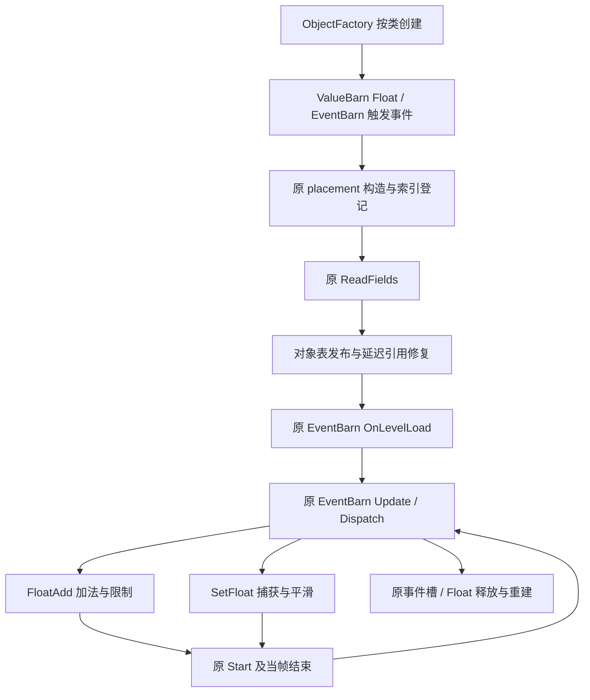

# FloatAdd 与 SetFloat 创建、字段装载与自动调度

FloatAdd 和 SetFloat 已接入原 ObjectFactory/ValueBarn/EventBarn 子链：原 placement 构造、触发槽与索引登记、保存字段装载、延迟引用修复、OnLevelLoad、Update、启用/停止请求、槽释放和数值重建。调度中的虚方法使用刚装载的 Event 本体与 Float 引用；没有跳过字段装载，也没有手工设置 enabled/loaded 来模拟执行。

[基础机器码对照](object-foundation-oracle.json) 扩展为 **2,278 组、40 个命名完整原函数、1 个装载器区间、161,651,548 字节对照，零差异**。本轮新增 289 组：225 组自动子链与 64 组 placement 未写字段保留检查。自动子链中 FloatAdd 为 184 组、SetFloat 为 41 组，包含全部 **31 个真实 FloatAdd 配置、4 个真实 SetFloat 配置**。

整个基础报告现在比较 2,435 个加载后/逐帧快照，其中本轮新增 1,813 个；SetFloat 比较 462 对 `logf/expf` 输入与结果的 float32 位模式。既有 FloatMult 的全部 14 个实际子图和 622 个快照继续通过。

## FloatAdd 的实际行为

本体 96 字节，Object 子对象仍在本体 +8。原 placement `0x100719390` 先执行 Event 构造，再写自身 classId/vptr；指针、amount、上下限与布尔字段由保存字段/default cache 装载，不能自行补零。

| 字段 | 本体偏移 | 原执行含义 |
| --- | --- | --- |
| target | `+0x38` | 加法输入，output 为空时也作为输出 |
| amountFloat | `+0x40` | 非空时读取 Float 值，为空时用 amount |
| output | `+0x48` | 非空时写入指定 Float |
| amount | `+0x50` | 标量增量 |
| minClampedValue / maxClampedValue | `+0x54` / `+0x58` | 启用相应限制时才参与比较 |
| useMinClampedValue / useMaxClampedValue | `+0x5c` / `+0x5d` | 原执行先 max 后 min |
| updateEveryFrame | `+0x5e` | false 时调用原 Start，由当前 Dispatch 当帧结束 |

原 Update `0x1007194a0` 读取 target 和 amount，加法后先限制上限，再限制下限；最后写 output 或 target。若下限为 5、上限为 0 且两个限制均启用，原顺序会输出 5，没有额外整理或交换上下限。

autoStart=false、amount=0.75、无 amountFloat/output 的样本，在加载和四帧的 target 为 `1.25 → 1.25 → 2 → 2 → 2.75`：只有启用请求触发单次加法，每次都当帧结束。target/amountFloat/output 三指针同指一个初值 -2 的 Float 时，逐帧反馈为 `-2 → -4 → -8 → -16 → -32 → -32 → -64`，停用帧不改值，后续启用继续读取已有值。

全部真实配置保留原标量字节、autoStart、字段顺序、对象创建顺序及引用关系。配置引用映射到至多四节点的局部对象表；空引用保持原 `0xffffffff`，由原引用修复产生 null。

## SetFloat 的实际行为

本体 88 字节，placement `0x1007175d0` 同样只恢复原构造写入。其原虚表与 FloatAdd 的区别见 [地址证据](numeric-event-chain-evidence.json)：

| 原函数 | 地址 | 状态行为 |
| --- | --- | --- |
| OnLevelLoad | `0x1007176e0` | 清零本体 `+0x4c..+0x53`，即 progress 与 initial value |
| OnEnable | `0x1007176f0` | 捕获 target 当前值到 `+0x50`，progress 清零 |
| OnResume | `0x100717710` | 同样重新捕获 target 并清零 progress |
| Update | `0x100717730` | 按原 GameTime、snappiness 与 duration 平滑更新；达到原阈值时写 targetValue 并调用 Start |

保存字段 targetValue/time/target/snappiness 分别位于 `+0x38/+0x3c/+0x40/+0x48`。初值与进度不是保存字段；它们由 load 和 enable/resume 的原方法初始化。

GameTime 仍按原 float32 顺序计算 speed×scale×delta，然后限制到原 `0.0001..0.266`；速度覆盖开关为 false 时取原常数 1。本轮覆盖负 delta、零 delta、正常/长帧、时间缩放和速度覆盖开关。输入通过准备的 Game/Time 内存提供，读取与计算由完整原 Update 执行。

停用不会重写平滑进度。重新启用时读取当前 target，因此外部在停用期间改值后，会从新值开始；样本第一次启用捕获 7，下一次捕获 3。达到结束阈值后原 Update 写入精确 targetValue，并由原事件状态机同帧收尾。

## 运行连接与剩余范围



[构造实现](../src/core/event-foundation-runtime.ts)、[原虚表适配器](../src/core/numeric-event-runtime.ts)复用既有[数值内核](../src/core/object-numeric-runtime.ts)、[SetFloat 内核](../src/core/set-float-runtime.ts)与[原 EventBarn 状态机](../src/core/event-barn-runtime.ts)。核验器执行原虚表目标，项目实现经同一已装载的 Buffer 执行对应逻辑。源码测试独立核对单次增量、别名反馈、限制顺序及重新捕获的预期结果，并重放完整原输出。

SetFloat 的 `logf/expf` 仍为明确数学服务：核验器捕获 Linux libm 的输入/输出位模式，项目重放这些服务结果并比较实际调用输入。**原 macOS libm 与目标硬件数学结果尚未验收**；零差异只适用于报告中说明的服务边界，未将这两项数学服务计作原完整函数。

metadata/继承转换、完整默认缓存准备、反射、堆与池内部、对象名字索引、多功能类共同装载、资源/UI/Avatar 场景反馈和完整切图仍待推进。本子图释放继续使用明确的已知事件槽。**完整原类和完整原实例计数保持为 0**，这些功能子链不等于完整关卡运行。

项目回归 **240 项全部通过**；TypeScript 检查与构建通过。逐类/逐对象进度和原调用图随本轮更新，完整类/实例计数保持不变。

```bash
npx tsx tools/object-foundation-oracle.ts /path/to/Sky
npx tsx --test tests/object-foundation-runtime.test.ts
```
