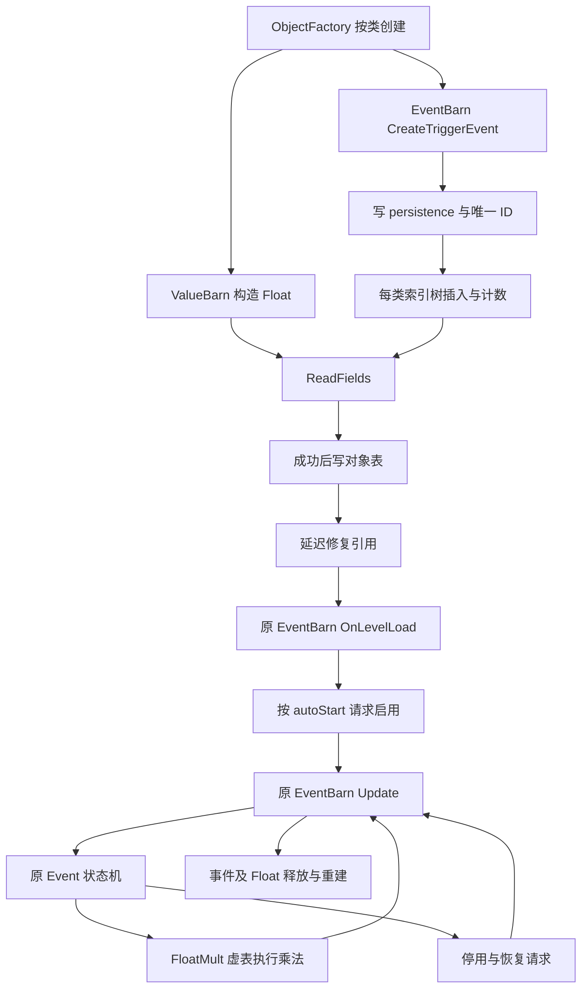

# FloatMult 触发登记与自动调度逆向

FloatMult 的功能子链现在由原 EventBarn 加载和逐帧更新驱动：创建 Float 和触发事件、装载保存字段、修复引用后，按 autoStart 请求启用，再由事件虚表执行乘法。停用帧调用原结束状态转换，后续启用恢复执行。自动模式没有绕开调度直接调用乘法，也没有手工设置 enabled/loaded 状态。

本说明记录 FloatMult 自动连接阶段的数据；后续 [FloatAdd/SetFloat 连接](FloatAdd与SetFloat创建装载自动调度逆向.md) 已将基础报告扩展至 2,278 组、40 个命名完整原函数。FloatMult 阶段的基础报告共 **1,989 组、33 个命名完整原函数、1 个明确装载器区间、136,957,972 字节对照，零差异**。新增 151 组触发输入：132 组运行至自动调度/释放/重建，19 组核验原断言及此前写入的状态；共比较 622 个加载后/逐帧快照。其中包含全部 **14 个实际 FloatMult 配置子图**，以及 27 种三指针别名的三种对象顺序。

[类型索引树报告](native-tree-oracle.json) 另有 217 组、7,698 次操作、14,221,312 字节对照，零差异，覆盖提示查找、重复键、uint32 边界、旋转及颜色翻转。

## 配置到功能的原调用顺序



| 本轮接入的原函数 | 地址 | 核验内容 |
| --- | --- | --- |
| CreateTriggerEvent | `0x10032ecf0` | 原通用创建、持久类型、唯一 ID、每类类型索引、失败保留状态 |
| uint32 提示插入查找 | `0x1003320e0` | 原子节点链接地址与 parent 输出 |
| 插入平衡 | `0x1001a7bb0` | 旋转、颜色与根链接 |
| 非空类型树递归销毁 | `0x10032fa30` | 左子树、重读右子树、内存池释放顺序 |
| GetMaxTypeIdx | `0x10032f1d0` | FloatMult 默认上限 255 |
| OnLevelLoad | `0x10032e540` | 按唯一 ID 排序、加载堆基线、autoStart 请求和原 load 虚方法 |
| Update / Dispatch | `0x10032ea90` / `0x10032f5b0` | 原事件槽捕获、序号排序、启用/结束/逐帧状态机与 scratch 分配释放 |
| 两个排序器 | `0x100330980` / `0x1003315d0` | load 唯一 ID 排序与 update 序号排序；本轮单事件子图调用原函数，多个事件排序由既有调度报告覆盖 |
| Enable / SetEnabled / Start | `0x10032e2f0` / `0x10032e2c0` / `0x10032ef60` | 保留原请求序号和 pending word；false 请求结束，由状态机消费 |

## 可观察的功能结果

别名反馈样本令 a=1.25、b=-2，output 指向 a。加载后和五帧的 a 依次为 `1.25 → -2.5 → -2.5 → -2.5 → 5 → -10`：第 2 帧请求停用，第 4 帧重新启用，停用期间保存值不变。这组结果由原执行文件输出，项目测试同时核对独立的数值与启用状态预期。

autoStart=false 样本在加载和首帧保持 output=0.5，收到启用请求才写入 -2.5；停用和恢复均经过原请求函数及 Update。加载时并不因未启用而跳过 load 虚方法，loaded 已置为 1。

唯一 ID 的 Barn 计数为 uint16，65534 可以创建，65535 触发原 Event.cpp:437 断言；读取超过 uint16 的准备值时保留原截断规则。每类索引为 uint8，当前索引必须小于虚表返回的上限；失败时再次查询上限用于诊断。成功时重新读取回调之后的索引，再写增量和 Event 索引，不添加原程序没有的回滚或溢出限制。

## 实现与范围

[原触发登记/清理](../src/core/native-event-barn-runtime.ts) 使用[类型树](../src/core/native-tree-runtime.ts)。[原槽引用适配器](../src/core/native-event-barn-view.ts) 把创建阶段的原指针映射为共享事件 Buffer，供[原 EventBarn 状态机](../src/core/event-barn-runtime.ts)读写；回调通过 nodes 修改槽，commit 写回槽与空闲链。[FloatMult 虚表适配器](../src/core/float-mult-event-runtime.ts)在 +0x48 读取已修复的 a/b/output，调用已核验的乘法；其原 load/unload/transition/destructor 方法为空函数。

实际配置保留 Float 值字节、autoStart 字节、原对象创建顺序和引用关系。原引用 ID 映射到四节点局部表；metadata/成员默认缓存、继承转换、反射、对象 size/alignment、堆和内存池内部、scratch/load heap 仍为明确服务。默认上限服务调用原 GetMaxTypeIdx；边界样本通过虚表服务提供上限和回调修改，未改写所核验原函数。

对象名字索引、完整 metadata/默认缓存注册、多功能类一起装载、真实资源/UI/Avatar 场景反馈及完整切图尚待恢复。槽释放在本子图中仍使用已知单槽位置。双 NaN 运算依赖原数值模块的明确服务。**完整原类和完整原实例验收仍为 0；已闭合的 FloatMult 自动功能子链不等于完整关卡玩法。**

项目回归 **234 项全部通过**；TypeScript 检查与构建通过。逐类/逐对象清单和原调用主链已更新；完整类/实例验收计数保持不变。

```bash
npx tsx tools/object-foundation-oracle.ts /path/to/Sky
npx tsx tools/native-tree-oracle.ts /path/to/Sky
npx tsx --test tests/object-foundation-runtime.test.ts tests/native-tree-runtime.test.ts
```
