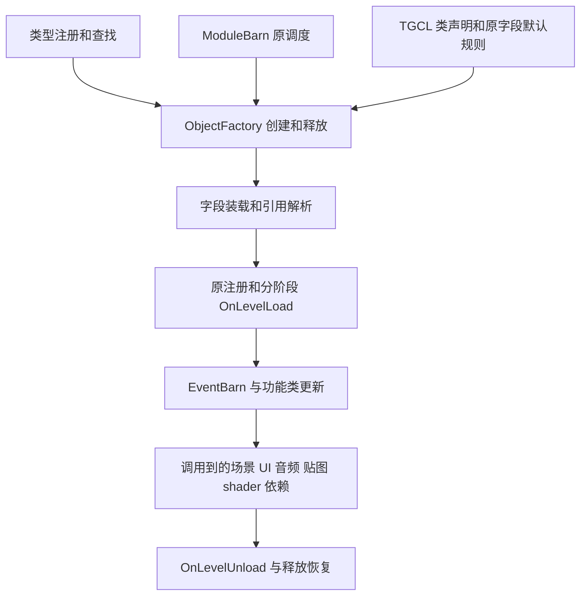

# Objects.level.bin 原调用主链与依赖推进

Objects.level.bin 第一；BstBaked.meshes 与 Avatar 第二。以原加载/创建/字段装载/类型转换/注册/更新/销毁调用依赖推进；引用到未实现的玩法、交互、UI、贴图、音频、shader 和跨模式功能一起恢复。当前图只建立明确入口及直接依赖，间接调用和未展开函数体保留；无 TGCL 引用不等于无原运行依赖。

实际入口、每条调用地址、未解析间接调用、原类型依赖和全部类见 [机器清单](object-call-chain.json)。当前不宣称已恢复整体游戏运行。

关卡文件职责、原 Resources.lua 语义、33关卡资产/对象/烘焙依赖见 [整体架构说明](关卡加载与资源整体架构.md) 和 [全关卡机器清单](level-dependency-audit.json)。

| 层次 | 原依赖推进范围 |
| --- | --- |
| 共享基础 | 原 metadata 类型注册/ID和名字树、Object 转换/虚表、堆、ValueBarn、ObjectFactory、TGCL 字段/引用装载；每个服务继续闭合原函数 |
| 基础数据类 | 先 Float/Value，再按原继承与字段依赖推进独立数据；没有序列化引用的类仅为候选，仍检查原虚方法/全局/资源 |
| 数值与事件功能 | FloatMult/FloatAdd/FloatSplit/SetFloat、Event/EventBarn、Clump/Enable/IfEnabled/Delay/OnFloat/ResumeEnable及Marker启用；有循环依赖的功能成组恢复 |
| 场景与交互功能 | Marker/Rail、区域触发、任务、对象变换、Timeline、UI 与音效；调用到资源/Avatar/BstBaked 缺口同时实现 |
| 完整验收 | 原场景加载→连续事件/更新→绘制/交互→卸载/恢复；所有类、实例及 Windows/原游戏逐项验收 |

图表示已定位的职责关系；实际执行由原条件分支、初始化优先级和模块顺序决定，不能按图中箭头自行重排。

| 原入口 | 地址 | 当前验收 |
| --- | --- | --- |
| Game.resourceBootstrap | `0x100376360` | 原反汇编；执行范围以独立 oracle 为准 |
| Game.queueBootstrapScript | `0x100375e40` | 原反汇编；执行范围以独立 oracle 为准 |
| Game.Initialize | `0x100376f80` | 原反汇编；执行范围以独立 oracle 为准 |
| Game.levelUnloadBranch | `0x1003781b0` | 原反汇编；执行范围以独立 oracle 为准 |
| Game.levelLoadBranch | `0x1003784a0` | 原反汇编；执行范围以独立 oracle 为准 |
| Game.updateBranch | `0x100378b60` | 原反汇编；执行范围以独立 oracle 为准 |
| ModuleBarn.build | `0x1007b0620` | 原反汇编；执行范围以独立 oracle 为准 |
| ModuleBarn.dispatch | `0x1007b1b40` | 原反汇编；执行范围以独立 oracle 为准 |
| LevelObjects.readSource | `0x10040d9e0` | 原反汇编；执行范围以独立 oracle 为准 |
| LevelObjects.TGCL | `0x10040bc00` | 原反汇编；执行范围以独立 oracle 为准 |
| LevelObjects.readFields | `0x10040b390` | 原反汇编；执行范围以独立 oracle 为准 |
| LevelObjects.readString | `0x10040b1d0` | 原反汇编；执行范围以独立 oracle 为准 |
| LevelObjects.registration | `0x10040eb90` | 原反汇编；执行范围以独立 oracle 为准 |
| ObjectFactory.Initialize | `0x1004d0680` | 原反汇编；执行范围以独立 oracle 为准 |
| ObjectFactory.CreateObject | `0x1004d0b60` | 原反汇编；执行范围以独立 oracle 为准 |
| ObjectFactory.ReleaseObject | `0x1004d0e00` | 原反汇编；执行范围以独立 oracle 为准 |
| ObjectFactory.GetObjectInitPriority | `0x1004d0fd0` | 原反汇编；执行范围以独立 oracle 为准 |
| ObjectFactory.methodLookup | `0x1004d2330` | 原反汇编；执行范围以独立 oracle 为准 |
| ObjectFactory.registration | `0x1004d1b40` | 原反汇编；执行范围以独立 oracle 为准 |
| Meta.byId | `0x1007abd30` | 原反汇编；执行范围以独立 oracle 为准 |
| Meta.byName | `0x1007abc80` | 原反汇编；执行范围以独立 oracle 为准 |
| Meta.restoreVptr | `0x1007abd80` | 原反汇编；执行范围以独立 oracle 为准 |
| Float.placement | `0x100716930` | 原反汇编；执行范围以独立 oracle 为准 |
| Float.heapConstruction | `0x1007168d0` | 原反汇编；执行范围以独立 oracle 为准 |
| Float.release | `0x100716910` | 原反汇编；执行范围以独立 oracle 为准 |
| ValueBarn.Initialize | `0x100715760` | 原反汇编；执行范围以独立 oracle 为准 |
| ValueBarn.CreateValue | `0x100716250` | 原反汇编；执行范围以独立 oracle 为准 |
| ValueBarn.ReleaseValue | `0x100716360` | 原反汇编；执行范围以独立 oracle 为准 |
| ValueBarn.OnLevelUnload | `0x100715cd0` | 原反汇编；执行范围以独立 oracle 为准 |
| ResourceManager.queueScript | `0x1007c38b0` | 原反汇编；执行范围以独立 oracle 为准 |
| ResourceManager.queueUnloadScript | `0x1007c2bd0` | 原反汇编；执行范围以独立 oracle 为准 |
| ResourceManager.processUnload | `0x1007c3010` | 原反汇编；执行范围以独立 oracle 为准 |
| ResourceManager.LoadNext | `0x1007c3d20` | 原反汇编；执行范围以独立 oracle 为准 |
| ResourceManager.registerResource | `0x1007c3e30` | 原反汇编；执行范围以独立 oracle 为准 |
| ResourceManager.unregisterResource | `0x1007c41e0` | 原反汇编；执行范围以独立 oracle 为准 |
| ResourceManager.AddToLoadList | `0x1007c2230` | 原反汇编；执行范围以独立 oracle 为准 |
| ResourceManager.AddToUnloadList | `0x1007c2250` | 原反汇编；执行范围以独立 oracle 为准 |
| Resource.IncLoadCount | `0x1007c1b40` | 原反汇编；执行范围以独立 oracle 为准 |
| Resource.DecLoadCount | `0x1007c1b50` | 原反汇编；执行范围以独立 oracle 为准 |
| Resource.GetLoadCount | `0x1007c1b60` | 原反汇编；执行范围以独立 oracle 为准 |
| ResourceManager.registration | `0x1007c5e60` | 原反汇编；执行范围以独立 oracle 为准 |
| LevelData.load | `0x1003f4840` | 原反汇编；执行范围以独立 oracle 为准 |
| LevelData.findBakedGuid | `0x1003f68d0` | 原反汇编；执行范围以独立 oracle 为准 |
| EventBarn.Update | `0x10032ea90` | 原反汇编；执行范围以独立 oracle 为准 |
| EventBarn.OnLevelLoad | `0x10032e540` | 原反汇编；执行范围以独立 oracle 为准 |
| EventBarn.ReleaseAll | `0x10032e920` | 原反汇编；执行范围以独立 oracle 为准 |
| Event.Start | `0x10032ef60` | 原反汇编；执行范围以独立 oracle 为准 |
| Event.constructor | `0x10032eea0` | 原反汇编；执行范围以独立 oracle 为准 |
| FloatMult.placement | `0x100719090` | 原反汇编；执行范围以独立 oracle 为准 |
| Event.registration | `0x100332290` | 原反汇编；执行范围以独立 oracle 为准 |
| FloatMult.execute | `0x1007191a0` | 原反汇编；执行范围以独立 oracle 为准 |
| EventBarn.Initialize | `0x10032e4a0` | 原反汇编；执行范围以独立 oracle 为准 |
| EventBarn.createEventTemplate | `0x100039f40` | 原反汇编；执行范围以独立 oracle 为准 |
| EventBarn.releaseNode | `0x10032f350` | 原反汇编；执行范围以独立 oracle 为准 |
| EventBarn.createTrigger | `0x10032ecf0` | 原反汇编；执行范围以独立 oracle 为准 |
| NativeString.growAndReplace | `0x1000198c0` | 原反汇编；执行范围以独立 oracle 为准 |
| FloatAdd.placement | `0x100719390` | 原反汇编；执行范围以独立 oracle 为准 |
| FloatAdd.Update | `0x1007194a0` | 原反汇编；执行范围以独立 oracle 为准 |
| SetFloat.placement | `0x1007175d0` | 原反汇编；执行范围以独立 oracle 为准 |
| SetFloat.OnLevelLoad | `0x1007176e0` | 原反汇编；执行范围以独立 oracle 为准 |
| SetFloat.OnEnable | `0x1007176f0` | 原反汇编；执行范围以独立 oracle 为准 |
| SetFloat.OnResume | `0x100717710` | 原反汇编；执行范围以独立 oracle 为准 |
| SetFloat.Update | `0x100717730` | 原反汇编；执行范围以独立 oracle 为准 |
| EventBarn.typeMapInsertion | `0x1003320e0` | 原反汇编；执行范围以独立 oracle 为准 |
| NativeTree.insertBalance | `0x1001a7bb0` | 原反汇编；执行范围以独立 oracle 为准 |
| EventBarn.clearTypeMap | `0x10032fa30` | 原反汇编；执行范围以独立 oracle 为准 |
| Event.GetMaxTypeIdx | `0x10032f1d0` | 原反汇编；执行范围以独立 oracle 为准 |
| EventBarn.Dispatch | `0x10032f5b0` | 原反汇编；执行范围以独立 oracle 为准 |
| EventBarn.sortUnique | `0x100330980` | 原反汇编；执行范围以独立 oracle 为准 |
| EventBarn.sortSequence | `0x1003315d0` | 原反汇编；执行范围以独立 oracle 为准 |
| Event.Enable | `0x10032e2f0` | 原反汇编；执行范围以独立 oracle 为准 |
| Event.SetEnabled | `0x10032e2c0` | 原反汇编；执行范围以独立 oracle 为准 |
| ObjectFactory.SetEnabled | `0x1004d1f60` | 原反汇编；执行范围以独立 oracle 为准 |
| ObjectFactory.GetEnabled | `0x1004d2050` | 原反汇编；执行范围以独立 oracle 为准 |
| Event.GetEnabled | `0x10032e2e0` | 原反汇编；执行范围以独立 oracle 为准 |
| Event.setWrapper | `0x10032fd60` | 原反汇编；执行范围以独立 oracle 为准 |
| Event.getWrapper | `0x10032fe80` | 原反汇编；执行范围以独立 oracle 为准 |
| Clump.placement | `0x10022c2d0` | 原反汇编；执行范围以独立 oracle 为准 |
| Clump.SetEnabled | `0x10022b7f0` | 原反汇编；执行范围以独立 oracle 为准 |
| Clump.AllocateClumpData | `0x10022b840` | 原反汇编；执行范围以独立 oracle 为准 |
| Clump.destroyData | `0x10022bd60` | 原反汇编；执行范围以独立 oracle 为准 |
| Clump.setWrapper | `0x10022c720` | 原反汇编；执行范围以独立 oracle 为准 |
| Clump.allocateWrapper | `0x10022c840` | 原反汇编；执行范围以独立 oracle 为准 |
| ClumpBarn.Initialize | `0x10022bdc0` | 原反汇编；执行范围以独立 oracle 为准 |
| ClumpBarn.CreateClump | `0x10022bf80` | 原反汇编；执行范围以独立 oracle 为准 |
| ClumpBarn.CreateCountedClump | `0x10022c000` | 原反汇编；执行范围以独立 oracle 为准 |
| ClumpBarn.ReleaseClump | `0x10022c0c0` | 原反汇编；执行范围以独立 oracle 为准 |
| ClumpBarn.OnLevelUnload | `0x10022bee0` | 原反汇编；执行范围以独立 oracle 为准 |
| Enable.placement | `0x100316c40` | 原反汇编；执行范围以独立 oracle 为准 |
| Enable.Update | `0x1003162f0` | 原反汇编；执行范围以独立 oracle 为准 |
| IfEnabled.placement | `0x100718210` | 原反汇编；执行范围以独立 oracle 为准 |
| IfEnabled.Update | `0x100718320` | 原反汇编；执行范围以独立 oracle 为准 |
| Event.Resume | `0x10032f0f0` | 原反汇编；执行范围以独立 oracle 为准 |
| LevelModelBarn.restoreVtables | `0x100407b20` | 原反汇编；执行范围以独立 oracle 为准 |
| AvatarSetPos.placement | `0x100149b30` | 原反汇编；执行范围以独立 oracle 为准 |
| AvatarSetPos.Update | `0x100149c40` | 原反汇编；执行范围以独立 oracle 为准 |
| AvatarBarn.FindLocalAvatar | `0x1000ff210` | 原反汇编；执行范围以独立 oracle 为准 |
| AvatarBarn.GetLocalAvatar | `0x1000fc260` | 原反汇编；执行范围以独立 oracle 为准 |
| Avatar.SetPosition | `0x100100fb0` | 原反汇编；执行范围以独立 oracle 为准 |
| Avatar.directionToEuler | `0x100146d00` | 原反汇编；执行范围以独立 oracle 为准 |
| AvatarPhysical.SetPosition | `0x100146de0` | 原反汇编；执行范围以独立 oracle 为准 |
| AvatarPhysical.SetPositionImmediate | `0x1001480d0` | 原反汇编；执行范围以独立 oracle 为准 |
| Avatar.eulerToForward | `0x100147510` | 原反汇编；执行范围以独立 oracle 为准 |
| AvatarBarn.IsLocalReady | `0x1000fe060` | 原反汇编；执行范围以独立 oracle 为准 |
| Avatar.MarkerForward | `0x10043d900` | 原反汇编；执行范围以独立 oracle 为准 |
| CollisionHit.materialChannel | `0x10022ddd0` | 原反汇编；执行范围以独立 oracle 为准 |
| CameraSystem.Initialize | `0x1001de020` | 原反汇编；执行范围以独立 oracle 为准 |
| CameraSystem.Update | `0x1001def10` | 原反汇编；执行范围以独立 oracle 为准 |
| WhiskerCamera.Initialize | `0x10073aa90` | 原反汇编；执行范围以独立 oracle 为准 |
| WhiskerCamera.Reset | `0x10073ab80` | 原反汇编；执行范围以独立 oracle 为准 |
| SetCameraShake.OnStart | `0x1003a0ec0` | 原反汇编；执行范围以独立 oracle 为准 |
| SetCameraShake.Update | `0x1003a0ee0` | 原反汇编；执行范围以独立 oracle 为准 |
| SetCameraKeyFrameShake.OnStart | `0x100591d90` | 原反汇编；执行范围以独立 oracle 为准 |
| SetCameraKeyFrameShake.Update | `0x100591da0` | 原反汇编；执行范围以独立 oracle 为准 |
| CameraSystem.AcquireCameraHandle | `0x1001e2ac0` | 原反汇编；执行范围以独立 oracle 为准 |
| WhiskerCamera.ShakeBasisHelper | `0x10073afd0` | 原反汇编；执行范围以独立 oracle 为准 |
| Delay.placement | `0x1002c62f0` | 原反汇编；执行范围以独立 oracle 为准 |
| Delay.OnEnable | `0x1002c6410` | 原反汇编；执行范围以独立 oracle 为准 |
| Delay.OnResume | `0x1002c6420` | 原反汇编；执行范围以独立 oracle 为准 |
| Delay.Update | `0x1002c6430` | 原反汇编；执行范围以独立 oracle 为准 |
| Delay.registration | `0x1002c6b70` | 原反汇编；执行范围以独立 oracle 为准 |
| FloatSplit.placement | `0x100717a10` | 原反汇编；执行范围以独立 oracle 为准 |
| FloatSplit.Update | `0x100717b20` | 原反汇编；执行范围以独立 oracle 为准 |
| OnFloat.placement | `0x100719e20` | 原反汇编；执行范围以独立 oracle 为准 |
| OnFloat.destructor | `0x100719f20` | 原反汇编；执行范围以独立 oracle 为准 |
| OnFloat.Update | `0x100719fc0` | 原反汇编；执行范围以独立 oracle 为准 |
| OnFloat.Evaluate | `0x10071a140` | 原反汇编；执行范围以独立 oracle 为准 |
| OnFloat.toObject | `0x100719e80` | 原反汇编；执行范围以独立 oracle 为准 |
| OnFloat.fromObject | `0x100719ea0` | 原反汇编；执行范围以独立 oracle 为准 |
| Marker.placement | `0x10043e1b0` | 原反汇编；执行范围以独立 oracle 为准 |
| Marker.SetEnabled | `0x10043cff0` | 原反汇编；执行范围以独立 oracle 为准 |
| Marker.GetEnabled | `0x10043e2c0` | 原反汇编；执行范围以独立 oracle 为准 |
| Marker.setWrapper | `0x10043e700` | 原反汇编；执行范围以独立 oracle 为准 |
| Marker.getWrapper | `0x10043e820` | 原反汇编；执行范围以独立 oracle 为准 |
| MarkerBarn.placement | `0x10043eaa0` | 原反汇编；执行范围以独立 oracle 为准 |
| MarkerBarn.Initialize | `0x10043d020` | 原反汇编；执行范围以独立 oracle 为准 |
| MarkerBarn.CreateMarker | `0x10043d6a0` | 原反汇编；执行范围以独立 oracle 为准 |
| MarkerBarn.ReleaseMarker | `0x10043d7a0` | 原反汇编；执行范围以独立 oracle 为准 |
| MarkerBarn.OnLevelUnload | `0x10043d030` | 原反汇编；执行范围以独立 oracle 为准 |
| MarkerBarn.Terminate | `0x10043d1d0` | 原反汇编；执行范围以独立 oracle 为准 |
| ResumeEnable.placement | `0x10058abf0` | 原反汇编；执行范围以独立 oracle 为准 |
| ResumeEnable.Update | `0x10058a9e0` | 原反汇编；执行范围以独立 oracle 为准 |
| Clump.OnResumeEnabled | `0x10022bba0` | 原反汇编；执行范围以独立 oracle 为准 |
| Clump.resumeWrapper | `0x10022cba0` | 原反汇编；执行范围以独立 oracle 为准 |
| Enable.OnResumeEnabled | `0x100316400` | 原反汇编；执行范围以独立 oracle 为准 |
| Enable.resumeWrapper | `0x100316df0` | 原反汇编；执行范围以独立 oracle 为准 |
| ObjectFactory.TryResume | `0x1004d2440` | 原反汇编；执行范围以独立 oracle 为准 |
| Marker.SetTransform | `0x10043ccd0` | 原反汇编；执行范围以独立 oracle 为准 |
| Marker.GetTransform | `0x10043e2d0` | 原反汇编；执行范围以独立 oracle 为准 |
| Marker.LocalObb | `0x10043e470` | 原反汇编；执行范围以独立 oracle 为准 |
| Marker.WorldObb | `0x10043e4b0` | 原反汇编；执行范围以独立 oracle 为准 |
| Marker.setTransformWrapper | `0x10043e520` | 原反汇编；执行范围以独立 oracle 为准 |
| Marker.getMatrixWrapper | `0x10043e640` | 原反汇编；执行范围以独立 oracle 为准 |
| Obb.Transform | `0x100076df0` | 原反汇编；执行范围以独立 oracle 为准 |
| ObjectFactory.SetTransform | `0x1004d1d50` | 原反汇编；执行范围以独立 oracle 为准 |
| ObjectFactory.GetTransform | `0x1004d1e40` | 原反汇编；执行范围以独立 oracle 为准 |
| ObjectFactory.GetObb | `0x1004d2140` | 原反汇编；执行范围以独立 oracle 为准 |
| ObjectFactory.Extents | `0x1004d2260` | 原反汇编；执行范围以独立 oracle 为准 |
| TransformObject.placement | `0x1006d94c0` | 原反汇编；执行范围以独立 oracle 为准 |
| TransformObject.OnLevelLoad | `0x1006d5d80` | 原反汇编；执行范围以独立 oracle 为准 |
| TransformObject.OnStart | `0x1006d6090` | 原反汇编；执行范围以独立 oracle 为准 |
| TransformObject.OnEnable | `0x1006d6370` | 原反汇编；执行范围以独立 oracle 为准 |
| TransformObject.OnStop | `0x1006d62e0` | 原反汇编；执行范围以独立 oracle 为准 |
| TransformObject.Update | `0x1006d6380` | 原反汇编；执行范围以独立 oracle 为准 |
| TransformObject.GetResumeEnabled | `0x1006d9150` | 原反汇编；执行范围以独立 oracle 为准 |
| TransformObject.OnResumeEnabled | `0x1006d9160` | 原反汇编；执行范围以独立 oracle 为准 |
| TransformObject.destructor | `0x1006d9240` | 原反汇编；执行范围以独立 oracle 为准 |
| LevelMesh.constructor | `0x1004003b0` | 原反汇编；执行范围以独立 oracle 为准 |
| LevelMesh.placement | `0x100403670` | 原反汇编；执行范围以独立 oracle 为准 |
| LevelMesh.SetTransform | `0x1003ffe10` | 原反汇编；执行范围以独立 oracle 为准 |
| LevelMesh.GetTransform | `0x100402ab0` | 原反汇编；执行范围以独立 oracle 为准 |
| LevelMesh.SetEnabled | `0x1003ffe50` | 原反汇编；执行范围以独立 oracle 为准 |
| LevelMesh.GetEnabled | `0x100402a80` | 原反汇编；执行范围以独立 oracle 为准 |
| LevelMesh.GetObb | `0x100402b10` | 原反汇编；执行范围以独立 oracle 为准 |
| LevelMesh.WorldObb | `0x100402b60` | 原反汇编；执行范围以独立 oracle 为准 |
| LevelMesh.BstGuid | `0x100402bc0` | 原反汇编；执行范围以独立 oracle 为准 |
| LevelMesh.setMatrixWrapper | `0x1004037c0` | 原反汇编；执行范围以独立 oracle 为准 |
| LevelMesh.getMatrixWrapper | `0x1004038e0` | 原反汇编；执行范围以独立 oracle 为准 |
| LevelMesh.setBoolWrapper | `0x1004039a0` | 原反汇编；执行范围以独立 oracle 为准 |
| LevelMesh.getBoolWrapper | `0x100403ac0` | 原反汇编；执行范围以独立 oracle 为准 |
| ResourceManager.nameRange | `0x1007c5970` | 原反汇编；执行范围以独立 oracle 为准 |
| ResourceManager.registeredLookup | `0x1007c4360` | 原反汇编；执行范围以独立 oracle 为准 |
| ResourceRef.constructor | `0x1007c2530` | 原反汇编；执行范围以独立 oracle 为准 |
| Resource.Observe | `0x1007c2310` | 原反汇编；执行范围以独立 oracle 为准 |
| ResourceRef.destructor | `0x1007c2570` | 原反汇编；执行范围以独立 oracle 为准 |
| ResourceRef.cleanup | `0x1007c2600` | 原反汇编；执行范围以独立 oracle 为准 |
| MeshInstance.Initialize | `0x10045f880` | 原反汇编；执行范围以独立 oracle 为准 |
| MeshInstance.ResourceConsumer | `0x10045fa00` | 原反汇编；执行范围以独立 oracle 为准 |
| LevelMesh.Load | `0x100400ed0` | 原反汇编；执行范围以独立 oracle 为准 |
| LevelMesh.Create | `0x100401040` | 原反汇编；执行范围以独立 oracle 为准 |
| Vertex.dataConstructor | `0x1007f5010` | 原反汇编；执行范围以独立 oracle 为准 |
| Vertex.renderDataConstructor | `0x1007f5b20` | 原反汇编；执行范围以独立 oracle 为准 |
| Vertex.renderDataForward | `0x1007f5d80` | 原反汇编；执行范围以独立 oracle 为准 |
| Vertex.autoLister | `0x1007f6ca0` | 原反汇编；执行范围以独立 oracle 为准 |
| MeshInstance.UnbakedConsumer | `0x10045f770` | 原反汇编；执行范围以独立 oracle 为准 |
| Model.MeshLodCount | `0x1004653c0` | 原反汇编；执行范围以独立 oracle 为准 |
| ModelBarn.CreateBaked | `0x10046ca30` | 原反汇编；执行范围以独立 oracle 为准 |
| ModelBarn.CreateUnbaked | `0x10046c700` | 原反汇编；执行范围以独立 oracle 为准 |
| Model.SetTransform | `0x100463750` | 原反汇编；执行范围以独立 oracle 为准 |
| Model.SetEnabled | `0x1004636d0` | 原反汇编；执行范围以独立 oracle 为准 |

原加载分支明确调用 OnLevelLoadEarly → OnLevelLoad → OnLevelLoadLate；卸载分支包括 OnLevelUnload、OnLevelUnloadLate、RenderFlush、PostRender，分支条件及实际模块执行次序需继续核验。

Meta ID／区分大小写的名字查找、Object 虚表恢复、ObjectFactory创建/释放/初始化优先级、ValueBarn槽链/卸载及Float构造→运算连续执行见 [基础核验](object-foundation-oracle.json)。`0x1007abd80` 是恢复虚表，不是 Object::Update；Float构造仅写classId，保留Value回链、值及padding。

ModuleBarn完整分发函数见 [分发核验](module-barn-oracle.json)。原内嵌Lua定义/引用/反射赋值/加载计数见 [资源脚本核验](resource-script-oracle.json)，全部37份资源脚本见 [原资源清单核验](resource-manifest-oracle.json)，LoadNext完整原函数见 [队列核验](resource-load-oracle.json)。这些报告只证明所列子链；实际metadata、资源加载虚方法、Lua VM接入、异步完成和模块实际行为继续保留依赖。

TGCL完整ReadString/递归ReadFields/字符串扩容及引用修复局部区间见 [字段核验](tgcl-field-oracle.json) 与 [范围说明](TGCL字段装载与引用修复逆向.md)：417组通过，含260组真实字段数据。metadata匹配/默认缓存准备、内存池和数组构造仍为未闭合依赖。

原Event/FloatMult构造、EventBarn初始化/通用槽创建/释放与字段装载连接见 [创建与事件槽连接](对象创建字段装载与事件槽连接逆向.md)：基础2278组、40个命名完整原函数及1个区间通过，含全部14/31/4个真实FloatMult/FloatAdd/SetFloat配置子图；2435个逐帧快照，0差异。原节点顺序保留，引用映射到局部表；槽注册先于字段装载，对象表写入在字段成功之后。原触发唯一ID/类型索引、树插入平衡/非空清理及OnLevelLoad/Update已接入，详见 [FloatMult自动调度](FloatMult触发登记与自动调度逆向.md) 与 [FloatAdd/SetFloat连接](FloatAdd与SetFloat创建装载自动调度逆向.md)。SetFloat原Mac libm仍未核验。对象名索引、完整metadata/default缓存、多功能类与实际场景生命周期继续闭合；完整TGCL和互动玩法未验收。

联合对象组与数值条件调用链见 [Enable/IfEnabled/Clump](Enable与IfEnabled对象组调用链逆向.md)、[Delay](Delay创建装载与对象组调度逆向.md)、[FloatSplit/OnFloat](FloatSplit与OnFloat条件事件调用链逆向.md) 、[Marker/ResumeEnable](Marker启用与ResumeEnable恢复调用链逆向.md) 和 [联合原输出核验](logic-chain-oracle.json)：906组、4313快照、398249100字节0差异，包含616个真实配置片段。25组原断言、1组字符串长度错误服务与227次缺失类服务边界分列。原字段与引用接到FloatSplit分段输出、OnFloat比较/嵌套/真或假对象组以及Delay时序，并接MarkerBarn池/原启用字段和ResumeEnable→TryResume→Clump/Enable检查点恢复或SetEnabled回退。真实片段最多6帧、48节点，有限执行通过不等于完整依赖图验收。完整metadata/default缓存、cast/Heap/pool、调试流/异常unwind、音乐beat、实际场景及资源/UI/Avatar目标仍待闭合，完整类和实例计数保持零。

原Marker空间接口与对象矩阵反射见 [空间变换记录](Marker空间变换与对象反射逆向.md)：13784组、6440572字节0差异，全部6538个真实Marker的GetTransform与SetTransform，以及40组MarkerBarn创建→启用/矩阵/OBB/extent反射→释放复用。Rail/Avatar出生定位使用同一字节内核；非有限算术/MXCSR、派生虚方法、TransformObject完整依赖和完整场景行为仍为未闭合依赖。

原对象变换与完成事件见 [TransformObject子链](TransformObject变换与完成事件逆向.md)：695组、5102完整内存快照、380591888字节0差异，全部317真实根配置中91跑完设定有限序列。198未知类和30次动作前依赖阻断分列；普通/continuous变换、起始/当前目标、两层平滑、恢复和完成Event请求接上原单EventDispatch。完整TGCL/metadata/default、音效、stepped、真实Timeline、LevelMesh等目标和场景生命周期仍待闭合。

本轮 [LevelMesh与Model状态连接](LevelMesh变换与Model状态连接逆向.md)：独立16699组、全部4133真实LevelMesh保存矩阵/GUID核验；连接887组、8322快照、636011224字节0差异，真实根有限通过由91增到250。原Model普通/延迟变换、启用与visible状态及LevelMesh虚槽GUID已接，真实Model指针为prepared加载前null，合成Model单列；实际资源/baked绑定、动画/提交/绘制/碰撞/卸载与完整场景仍待闭合。

资源查找本轮见 [注册表与模型消费者](ResourceManager注册表查找与模型消费者逆向.md)：7,885查询/1,206,824字节以及连接12,069组/101,625,444字节0差异；原同名范围、精确类型选择、ID getter接回原引用/消费者。树注册/bootstrap、metadata转换/真实加载、完整Model创建与LevelMesh绑定仍待闭合。

ModelBarn完整创建wrapper与LOD查询见 [槽分配与参数连接](ModelBarn槽分配参数与LOD查询逆向.md)：2410组/2685560004字节以及查询1168组/9726868字节0差异；池限制/计数提交/参数字节保留。完整constructor仍为明确捕获服务，完整Model创建和实际LevelMesh绑定仍0。

无烘焙消费者与Vertex数据构造见 [数据构造依赖](Vertex数据构造与无烘焙模型消费者逆向.md)：1436组/11958208字节和186组/419快照/3438712字节0差异；已接原资源查找/引用及内嵌AutoLister正常登记。GPU上传/队列/绘制/释放、完整Model创建和场景生命周期仍待闭合。

地图可见效果见 [Objects对象变换播放](Objects对象变换地图播放.md)：显式选择TransformObject，恢复的变换内核与单Event dispatch驱动Marker/LevelMesh编辑器矩阵，支持TransformObject完成接力与循环，可暂停/继续/停止还原。33地图317配置中246满足当前依赖；原Model指针为prepared null，显示已有编辑器网格。音效/Timeline及其他完成目标明确阻断。候选可用性、11个真实根矩阵回归与Electron/Vulkan播放检查不计作完整原类/实例验收。

原完成事件接力见 [循环变换地图播放](Objects完成事件与循环变换地图播放.md)：EventBarn完整Update及排序连接TransformObject完成请求和Event::SetEnabled；5真实根、320帧完整准备状态、11104768字节0差异。初始化的编辑器快照/metadata/槽登记/Heap/GameTime仍是准备输入及服务，原资源/Model/GPU/碰撞/音效/完整场景未验收。

对象组/条件/延迟地图效果见 [Enable、IfEnabled与Delay播放](Objects对象组启用延迟与条件地图播放.md)：四类共540个配置满足字段/递归依赖预检，另需实际模型已加载；原EventBarn完整Update/排序与首帧load/enable/update/finish连接嵌套Clump、Marker/LevelMesh启用与后续TransformObject。301组（293真实根、8合成混合链）、7525帧、263925600字节0差异；每根25帧，长Delay可能仍在等待。Clump缺GetEnabled默认true与原Delay帧时间钳制保留，暂停/停止还原及编辑/模式/切图清理已接入。准备字段/metadata/槽顺序/Heap/GameTime与Linux libm仍是明确输入/服务，Model为prepared null；完整原资源/Model/GPU/碰撞/音效/Avatar/场景与完整类/实例仍待验收。

数值与平滑地图效果见 [FloatAdd、FloatMult与SetFloat播放](Objects数值与平滑控制地图播放.md)：七类589个配置满足字段/递归依赖；362组、9146帧、307419512字节原对照0差异，真实数值配置31/14/4全部覆盖。SetFloat与TransformObject共用Float，原time=0配置首帧结束；临时平台接线、两种单次控制变换和logf/expf服务单独核验。准备输入、JS Math预览、Model/GPU与完整场景边界保留，完整类/实例计数不变。

条件与分段数值地图效果见 [OnFloat与FloatSplit播放](Objects条件与分段数值地图播放.md)：九类596配置满足字段/依赖预检；396组、9676帧、323130696比较字节0差异，含349真实根与47准备输入。3 OnFloat、全部2 FloatSplit及新增2 Delay真实根接入；双侧嵌套BODY条件/原反转字节、Object分支、短字符串、独立结束请求及Float分段别名写序保留。准备DayHubCave阈值0.35→Delay 0.5秒→原平台变换，15字段修改和同相机渲染帧截图/暂停/还原/清理单列。debug输出、长字符串池与同步条件求值循环阻断；原材质非有限RGB错误、Model/GPU、Avatar与完整场景未验收，完整类/实例仍为零。

共 283 个声明类；84 个类没有实际非空序列化引用，仅作为基础候选。原基类 getter 已定位 222 类；继承、虚调用、全局和资源依赖未完成者均保留未知。

重建：`python3 tools/reverse-object-call-chain.py /path/to/Sky`；基础执行核验：`SKY_DATA=/path/to/Data npx tsx tools/object-foundation-oracle.ts`。
