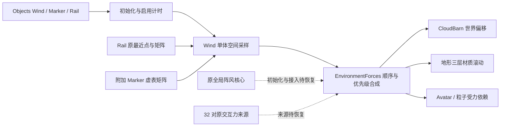

# Wind 与 EnvironmentForces 风场采样

已恢复原 Wind 单体采样、附加 Marker 范围、轨道采样分支、EnvironmentForces 优先级合成/最强交互力选择，以及 Wind 启用计时子段。基础检查 1,422 组、4,664 个有效 float32 分量与原机器码逐字节一致。

完整风场仍未接入主视口。当前视口 sampled wind 继续采用已说明的零输入；globalWind 阵风核心另有 256 组原指令子段对照，见 [全局阵风逆向](全局阵风逆向.md)。Rail 缓存、正常输入最近点与变换现已核验，另有 1,638 组原 Wind → Rail 连续调用对照；对象初始化/启用事件、自动粒子/交互力来源和完整 Update 尚未闭合。该检查不能代表游戏云画面一致。

## 原数据与接口

实际 33 张地图有 120 个 Wind：96 个文件 enabled=true、24 个 false；26 个引用 Rail，4 个引用附加 Marker Clump。文件 enabled 不代表完成初始化/事件后的最终运行状态。

| 原地址或字段 | 本轮恢复范围 |
| --- | --- |
| `0x100328810` | Wind 时间权重、空间衰减、方向和 intensity |
| `0x10078ce10` | 原半轴矩阵 OBB 世界空间距离及微小轴分支 |
| `0x100076df0` | Wind transform 与 diag(0.5,0.5,0.5,1) 的原矩阵乘法 |
| `0x100328200` | 完整优先级采样/合成控制流及 32 对交互力遍历 |
| `0x100324b62..0x100324b8d` | Wind timer 原指令子段 |
| EnvironmentForces `+0x48c0` / `+0x48d0` | Wind 数量 / 32 个 0xd0-byte 预构造槽 |
| Wind `+0xc8` | 运行计时；不在 Objects 文件字段中 |

Wind 公开字段的类型和偏移在 [native-properties.json](native-properties.json)：transform +16、enabled +80、fadeDist +84、fadeTime +88、intensity +92、order +96、additionalWindMarkers +104、rail +112。

另从原 `0x10032ca80` 注册指令提取了 10 个 Tool_DefaultValue 标签：order=0、fadeDist=1、fadeTime=3、intensity=5、enabled=true、spawnParticle=true、minDist=30、maxDist=50，以及 additionalWindMarkers/rail 的 NULL。两个引用默认标签保留为未完成转换，未用来生成运行指针；8 个标量编码与原类型和 scalar strtod 路径核对。完整构造及私有 +0xc8 计时初始化仍待验证。见 [wind-defaults.json](wind-defaults.json)，重建命令为 `python3 tools/reverse-environment-defaults.py /path/to/Sky --wind`。

## 单体与计时规则

无 Rail 时，先将 transform 的三个轴缩为半轴，再求 OBB 世界空间距离。附加 Marker 的虚表矩阵 getter 输出经原矩阵乘法得到额外范围；取所有距离的最小值。此采样没有检查各附加 Marker 的 enabled。

fadeDist=0 时盒体边界包含在范围内；其他值按 `clamp(1-distance/fadeDist,0,1)` 衰减。方向采用 transform 第三轴的负方向，长度超过原 0.00001 阈值才归一化。

有 Rail 时，先由原最近点函数提供位置及参数，再由 Rail 变换函数提供矩阵。基础 1,422 组检查供给两个回调结果；新增 1,638 组检查连续执行两个原函数，覆盖全部 26 个实际 Rail Wind。范围半径为前两轴长度的较大值；fadeDist=0 使用严格 `distance < radius`。方向来自 Rail 第三轴。核心接口支持显式 `rail` 缓存，并仅在时间权重大于零时求值。

enabled=false 时单体风采样直接为零；enabled=true 且 fadeTime=0 时权重为 1，否则为 timer/fadeTime。计时子段按启用状态加/减已缩放帧时间，先与 0 取最大，再与 fadeTime 取最小。完整 Update 的粒子、音效和对象状态尚未恢复。

## 合成规则与调用关系

原采样按存储顺序访问 Wind，向量平方长度超过 0.0001 才参与优先级处理。较高 order 出现时会清空两组累计向量、计数和时间权重；因此不能预先按 order 排序再采样。同优先级向量取平均，空间/时间权重另取平均，后续逐 float32 指令合成。

交互力槽按 A0、B0、A1、B1……A31、B31 顺序访问；选择 xyz 长度最大的有效力，长度相同保留先出现的力。它们不是简单相加。最终叠加 EnvironmentForces +0x30 的 globalWind、Wind 两组贡献和最强交互力。

此图描述已定位调用依赖和实现边界；桌面自动调用链尚未连接。

## 验证范围

910 个单体场景包括人工边界/尺度/负值、Rail 和附加 Marker 分支，以及 90 个无对象引用 Wind 的实际地图矩阵/字段输入；30 个引用对象的真实节点单独保留，不为其填入虚构运行结果。另有 256 个优先级/交互力场景和 256 个计时场景。

原单体及合成函数在 QEMU x86_64 下运行；矩阵乘法、OBB 距离和 Marker 元类转换执行原机器码。Marker 虚表 getter、Rail 求值及交互力公式为明确回调输入。计时使用原地址的原指令子段，以 RET 作为测试出口；不宣称整个 EnvironmentForces::Update 已执行或恢复。

仅比较语义 xyz、单体 weight 和 timer；SIMD scratch W 不计入范围。JSON 会丢失负零，回归样本额外保存负零输入路径，测试先恢复位符号再比较原输出。

实现：[environment-wind.ts](../src/core/environment-wind.ts)。报告：[environment-wind-oracle.json](environment-wind-oracle.json)。重建：`npx tsx tools/environment-wind-oracle.ts`。Objects / Avatar 清单：[Objects与Avatar清单.md](Objects与Avatar清单.md)。

新增 Rail 证据：[Rail轨道逆向.md](Rail轨道逆向.md)、[wind-rail-oracle.json](wind-rail-oracle.json)。1,638 组、6,552 分量原函数／记录的 Linux sincosf 返回值逐位通过；直接 JS sincos 有 4 组差异。默认 timer、运行 enabled、动态缓存和 macOS libm 仍保持明确边界。
