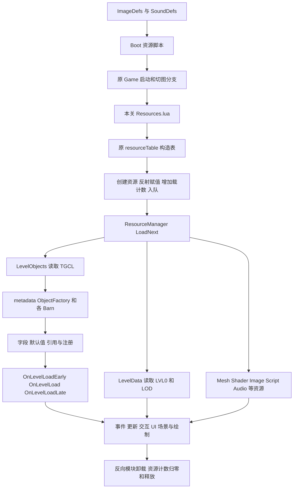

# Sky 0.3.18 关卡加载与资源整体架构

本说明以原执行文件和原 33 份关卡为依据。第一优先级是 `Objects.level.bin`；它调用到的 BstBaked、Avatar、事件、UI、模型、纹理、声音和 shader 依赖一起推进。当前已还原部分基础子链，完整关卡运行仍未验收。

原执行文件 SHA256：`3fa493e2542638299fd54d64e1b62aeb5b81c8f290176d955c3e38a27fa72b20`。资源 DSL 的原 Lua 源码来自执行文件 `0x100adb9c0..0x100ae089a`，见 [原源码](../evidence/original-resource-dsl.lua)。

## 各文件承担什么职责

| 文件 | 原职责 | 怎样连接到其他文件 |
| --- | --- | --- |
| `Resources/ImageDefs.lua` | `resourcedef` 图像构造定义 | 定义保存在全局定义表；其他脚本用 `resourceref` 将定义加入加载表。定义本身不立即加载图像 |
| `Resources/SoundDefs.lua` | FMOD 文件/Bank 资源、部分 SoundDef | 普通 `resource` 加入加载表；`soundDefResources` 展开共享设置和单个声音设置 |
| `Resources/Boot.lua` | 启动所需 shader、字体、脚本、图像区域等 | 声明的 Script 可以带 `autoRun`；资源声明解析与实际执行 Script 是两个步骤 |
| `Resources/Persistent.lua` | 跨关卡资源 | 原启动 update 分支在初始 intro 关卡载入后再排队此脚本，不能把静态目录读取顺序当作游戏执行顺序 |
| `Levels/<关卡>/Resources.lua` | 本关资源构造清单 | 同名 `LevelObjects` 和 `LevelData` 将对象文件与烘焙文件配对；此外声明 Mesh、shader、图像引用等 |
| `Objects.level.bin` | TGCL 类声明、字段、对象实例、对象间引用 | 通过原 metadata / ObjectFactory 创建类，装载字段和引用；功能类再调用场景、事件与共享服务 |
| `BstBaked.meshes` | LVL0 关卡烘焙数据 | 模型烘焙记录按 GUID 被对象消费；LOD0 还包含地形、云体、裙边和遮挡网格 |
| `Meshes/Bin/<名字>.mesh` | 独立 Mesh 资源 | 提供模型几何及 LOD，可能带骨骼/动画数据；不是每个模型的几何都内嵌在 BstBaked 中 |
| `Shaders/Bin`、`Images/Bin`、`Tex3D` | 程序和二维/三维采样资源 | 材质/shader 参数和共享云等服务消费；文件存在不等于原 GPU 上传和绘制链已实现 |
| `Audio` | 波形与 FMOD Bank/事件数据 | Objects 的声音字符串由原 SoundManager 消费，可能走 FMOD 事件路径，不能只按 SoundDef 表判定 |
| `Scripts`、`BlobPrefabs`、`Vars` | 运行脚本、预制 TGCL、变量配置 | 构造/热更新/默认值/功能调用会继续引入依赖；当前依赖图不宣称已经遍历这些文件的全部执行内容 |

## 原程序怎样装载关卡



图表示职责连接。实际次序由队列、原初始化优先级、模块顺序和分支条件共同决定，不能按图自行重排。

| 原入口 | 地址 | 已确认内容 |
| --- | --- | --- |
| 启动资源 | `0x100376360` | 按 ImageDefs → SoundDefs → Boot 调用启动资源队列/排空帮助函数 `0x100375e40` |
| 排队资源脚本 | `0x1007c38b0` | 清 `resourceTable`、执行文件、调用 `QueueResourcesForLoad`、再清表并检查错误码；定义表保留 |
| 本关加载分支 | `0x1003784a0` | 在 `0x1003787f5` 排队本关 Resources.lua；`0x100378835` 调用 LoadNext 时 allowAsync 为 true；load list 排空后正向分发三个 OnLevelLoad 阶段 |
| 入加载/卸载表 | `0x1007c2230` / `0x1007c2250` | 加载从头插入，配合 LoadNext 尾部取出形成 FIFO；卸载先注销，再用独立 `+0x68` 链接 |
| 加载计数 | `0x1007c1b40` / `0x1007c1b50` / `0x1007c1b60` | `+0x58` 的 32-bit 增、减和读取，保留原整数回绕 |
| 阶段分发 | `0x1007b1b40` | 名称二分查找、正反向遍历、mode 过滤、反射调用与一次性 override；回调后重新读取数量 |
| 对象读取 | `0x10040d9e0` | 对 LevelObjects.source 追加 `.bin`，调用 TGCL loader；后续注册热更新查询及生成对象类型 hash |
| TGCL 装载 | `0x10040bc00` / `0x10040b390` | 匹配序列化类/字段与原 metadata，创建对象、读字段和处理引用；完整字段读取已核验，整个装载器尚未执行闭合 |
| 创建对象 | `0x1004d0b60` | 通过类的注册创建方法和所属 Barn 分发；释放/初始化优先级为 `0x1004d0e00` / `0x1004d0fd0` |
| 烘焙装载 | `0x1003f4840` | LevelData 读取指定 LOD，处理模型/地形/云/裙边/遮挡数据及资源绑定；完整函数仍需恢复 |
| 烘焙查询 | `0x1003f68d0` | 要求资源 handle 和资源存在、载入索引为非负 int32；线性返回第一个相等 GUID |
| 切图卸载 | `0x1003781b0` | 反向模块分发后进入资源卸载路径；原资源脚本减加载计数，归零才排入卸载表 |
| Persistent 排队 | `0x100378b60` 内 `0x100378cc3` | 初始 intro 加载后的启动 update 路径；原 LevelSelect 的 intro 是 TitleWater，tutorial 是 Dawn |

完整函数边界、直接调用、尚未解析的间接调用见 [原调用图](object-call-chain.json)。

## Resources.lua 的真实语义

`resourceTable` 是有顺序的构造表。`resourcedef` 用 `class .. "_" .. name` 做 key，将调用方的同一个构造 table 保存到 `resourceDefTable`。`resourceref` 只查询这个定义表，通过过滤后把同一 table 放进 `resourceTable`。缺定义会打印警告并设置 `resourceErrorCode = 1`。普通 `resource` 不自动成为 `resourcedef`。

加载已有资源时，原 Lua 对每个有反射 accessor 的配置字段做 `~=` 比较，一旦不同就设错误码并报错，之后不会增加该次加载计数。Lua table 按身份比较；实现不能擅自改成内容深比较。加载新资源时是 `.new(alloc)` → 设置有 accessor 的字段 → 设 heap → AddToLoadList → IncLoadCount。未知 accessor 字段被忽略。

数组字段通过反射的 `ArrayAllocator` 先分配，断言长度正确，再用 **0 起始索引** 写元素。`LevelObjects.sources` 就依赖这个规则。manager 的 GetResource 未必能查到尚未注册的 load-list 项；重复声明不能被实现自行去重。

`AddToLoadList` 从 load list 头部插入，`LoadNext` 取尾项，因此新资源按构造表顺序进行第一次加载尝试。已有资源只增加计数，不重新入队。LevelObjects 的声明在本关清单最前面，通常先进入读取/创建过程；模型和烘焙消费还涉及后续原生命周期，不能因此把依赖资源提前伪造为已加载。

`LoadNext` 先注册，再清资源 `+0x38` 的四个状态字节，检查 heap，调用资源虚表 `+0x10`。如果仍在等待，按 `+0x28` 和 allowAsync 进入异步表，或切换 `+0x3a` 并继续同步加载。本关分支明确传入 allowAsync=true；所以 load list 排空不能单独证明异步工作已经完成。注册/注销的内部结构、异步工作线程和每类资源虚方法仍是独立依赖。

卸载再次执行资源清单，逐项 DecLoadCount，恰好为零时 AddToUnloadList。这个原函数先从资源注册表注销，再用资源 `+0x68` 连接 manager `+0x4d0` 的卸载表；加载和异步使用的链接是 `+0x60`。计数是原 32-bit 增减，不能擅自钳制到零。没有查到资源时留给原 native 待加载队列清理路径。解析器、静态 AssetCatalog 和真正资源 manager 的载入状态不能混为一谈。

`soundDefResources` 将共享配置放在底层，单声音设置覆盖共享设置，并展开 source、instanceLimit、LOOP/STREAM/PRELOAD 等简写。它使用 `pairs()`，声音组内的遍历次序不是 Lua 的稳定承诺。图集 UV 的 `.75`、`1/8+1/8` 等数值常量也已解析；任意函数调用和未知 Lua 表达式仍明确拒绝用于运行构造。

## Objects 与 BstBaked 怎样配合

以 Dawn 为例，Resources.lua 第 4 行声明 `LevelObjects "Dawn"`，source 为 `Levels/Dawn/Objects.level`；第 179 行声明 `LevelData "Dawn"`，source 为 `Levels/Dawn/BstBaked.meshes`，`lodToLoad = 0`。前者真正读取的文件是 `Objects.level.bin`。

它的 24 个 `sources` 是构建输入层，如 Art、Collision、Env、Hints、LocatedAudiioSources 等；不能在游戏读取编译后的 Objects.level.bin 时再当作 24 个额外 TGCL 文件加载。

Dawn 有 3,798 个顶层对象、5,175 条非空对象引用和 166 个关卡资源构造项。LOD0 按顺序分成：

| 逻辑段 | 记录数 | 内容 |
| --- | ---: | --- |
| Mesh.bin | 402 | 模型 GUID、LOD 数量和烘焙光照/映射数据 |
| Terrain.bin | 2 | 烘焙地形几何、碰撞/网格和边表 |
| Cloud.bin | 1 | 稀疏云体、距离/环境采样及代理几何 |
| Skirt.bin | 147 | 裙边顶点和索引 |
| Occluder.bin | 1 | 遮挡几何 |

这些是已有解析器完整切分的逻辑区域，不是必须分别存在的五个外部文件。

Dawn 的对象 n7 是 LevelMesh，GUID `1049166257`，资源名 Cube；bake0 记录相同 GUID 和 Cube。实际模型几何仍来自独立 Mesh 资源，烘焙记录提供对应 LOD 的光照数据。**原绑定函数按 GUID 查找，不比较资源名**；同名多个模型可以各有不同 GUID。TGCL 的对象引用索引、对象名字、bstGuid 和资源名是不同机制。

找到记录后还有兼容检查：Beamo 检查 LOD 数量，CloudCard/模型消费路径检查首个 LOD 顶点数量。原 loader 会在资源缺失或采样不匹配时跳过、清空或改变记录状态。因此静态文件里匹配成功，只证明保存数据之间有关系，不能直接当作最终加载表。

## 全关卡核查与已实现范围

[全关卡机器清单](level-dependency-audit.json) 包含 33 对关卡文件的 hash、构造清单、来源层、逐对象引用、逐烘焙记录/GUID 候选、Mesh/shader/纹理/声音请求和资产候选路径。总计 49,824 个对象、60,016 条引用、10,653 条烘焙记录，10,592 条有序列化对象 GUID 候选；1,005 个对象引用的独立 Mesh 名称。

507 条声音请求没有命中静态 SoundDef 声明，例如 BirdSoarFlap、StoneImpact、DistantBeach。它们继续沿 SoundManager 和 FMOD Bank/事件路由逆向，不能据未命中 SoundDef 就改用猜测的 WAV。61 条没有当前序列化对象 GUID 候选的烘焙记录也保留；动态创建/动画/跨模式依赖需要继续恢复。

| 已实现子链 | 原依据与核验 | 尚缺 |
| --- | --- | --- |
| 静态资源读取和关卡配对 | 37 份原资源文件、487 个定义、3,949 次构造聚合与原 Lua 一致 | 完整 Lua 执行器和非字面表达式 |
| ResourceScriptRuntime | 57 组原 Lua 对照：locale/filter/引用身份、反射赋值、数组、加载计数、未注册队列与卸载 | native metadata/accessor、manager 与 allocator 接入 |
| Resource 基础计数和 ResourceManager 队列 | 123 组、6 个完整原函数对照：入队→FIFO加载→计数→注销/入卸载表连续链，状态/异步/同步循环/断言 | 注册/注销内部、资源虚方法、异步完成 |
| Object / ObjectFactory / ValueBarn / EventBarn / Float / FloatMult | 2,278 组、40 个命名原函数及 1 个区间；创建/触发唯一ID及类型索引/装载/修复/自动OnLevelLoad与Update/槽释放/ValueBarn重建；全部14/31/4个真实FloatMult/FloatAdd/SetFloat局部子图、2435个逐帧快照，零差异 | 完整 metadata/默认缓存、堆内部、对象名字、多功能类和实际自动场景生命周期 |
| TGCL 字段与引用子链 | 417 组、3 个完整原函数和 1 个装载器区间，零差异；260 组真实字段字节覆盖 Float/Clump/Marker/LevelMesh/LevelMaterial/Timeline | metadata 匹配和默认缓存准备、内存池、数组构造与完整场景连接；此报告的真实样本引用尚未修复 |
| ModuleBarn dispatch | 244 组完整原分发函数对照 | 调度表构建、各模块实际阶段行为 |
| 模型烘焙、材质、事件、声音等已恢复子链 | 各独立报告和 [联合依赖清单](模型材质底层统一清单.md) | 原场景生命周期、动画、GPU、交互/UI 和完整资源服务 |

上述基础实现按原职责暴露尚缺服务，未实现的服务不会被假加载或预览效果冒充。下一层从资源类型注册与 TGCL 字段/引用装载推进到实际 Barn 注册，再沿功能类调用到的事件、材质、模型、Avatar、UI 和声音分支闭合；切图销毁与状态恢复一起验收。

实现入口：[资源脚本基础](../src/core/resource-script-runtime.ts)、[原资源内存/队列](../src/core/resource-load-runtime.ts)、[脚本与原队列连接](../src/core/resource-script-native.ts)、[资源声明读取](../src/core/resource-manifest.ts)、[同名关卡资源配对](../src/core/level-resource-plan.ts)。连接层使用已恢复的真实内存布局/计数/链表，将未恢复的 metadata、分配、反射转换和注册查找保留为明确接口。

字段装载入口：[TGCL 字段实现](../src/core/tgcl-field-runtime.ts) 和 [原字符串布局](../src/core/native-string-runtime.ts)。[字段装载逆向说明](TGCL字段装载与引用修复逆向.md) 明确完整函数、局部区间及准备服务的范围。字段子链通过不代表原关卡加载、完整类或互动玩法已验收。

[对象创建与事件槽连接](对象创建字段装载与事件槽连接逆向.md) 记录原EventBarn通用槽注册发生在字段装载之前，对象表写入发生在字段读取成功之后。触发包装器 `0x10032ecf0` 的 persistence/唯一ID/类型索引和原OnLevelLoad/Update已接入，见 [FloatMult自动调度](FloatMult触发登记与自动调度逆向.md) 和 [FloatAdd/SetFloat连接](FloatAdd与SetFloat创建装载自动调度逆向.md)。局部子图由原事件更新驱动，但尚不等于完整关卡生命周期。

## 重建与验收

```bash
npx tsx tools/resource-script-oracle.ts /path/to/Sky
SKY_DATA=/path/to/Data npx tsx tools/resource-manifest-oracle.ts /path/to/Sky
npx tsx tools/resource-load-oracle.ts /path/to/Sky
SKY_DATA=/path/to/Data npx tsx tools/tgcl-field-oracle.ts /path/to/Sky
SKY_DATA=/path/to/Data npx tsx tools/level-dependency-audit.ts
python3 tools/reverse-object-call-chain.py /path/to/Sky
```

原机器码核验使用 x86_64 gcc 和 qemu；原内嵌 Lua 核验使用 Lua 5.1，并验证所执行源码逐字节等于 SHA 锁定的执行文件片段。清单中的资产路径是原语料/现有解析器提供的候选，存在和格式验证不自动计为原游戏完整加载、播放、绘制或真机行为。
