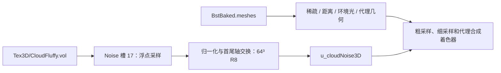

# 实体云、Tex3D 与 Vulkan 源码进展

当前体积数据和噪声资源链已恢复；完整实体云绘制仍未完成；BstBaked.meshes 编辑、碰撞重建和新增烘焙开发无限期停止。发布包保持 0.2.0，尚未重新打包。

## 真实资源来源

| 输入 | 已确认内容 | 原程序用途 |
| --- | --- | --- |
| BstBaked.meshes 云记录 | 稀疏网格、距离场、三组环境光、代理几何 | CloudSparseGrid、CloudPackedDistGrid、CloudPackedAmb0/1/2Grid |
| Tex3D/CloudFluffy.vol | VOLU v4，64³ 单通道 byte | Noise 槽 17，CloudBarn 初始化读取并生成 CloudNoise3D，绑定 u_cloudNoise3D |
| Tex3D/PerlinNoise.vol | VOLU v4，32³ 单通道 byte | Noise 槽 0，通用噪声输入 |
| Tex3D/CloudNoise.vol | VOLU v4，128³ 单通道 byte；内部名 VoronoiBallNoise.vol | Persistent.lua 声明预加载；此版本 Noise 初始化未从该文件填充槽 16，实体云初始化读取槽 17 |

原资源表位于 `0x100c17500`。Noise 初始化 `0x1004b72d0` 的跳转表明确只在槽 0 和 17 调用文件加载器；槽 16 设置尺寸和比例，不走该文件读取分支。文件名相似不能代替实际调用链证据。



## 已恢复并验证

- VOLU 原加载器 `0x1004ba510`：4096-byte 头部；magic/version 位于 0/4；立方分辨率位于 0x10c；格式/通道位于 0x110/0x114，均为 1；体素从 0x1000 开始。头部其他导出器字节不解释。
- 原 byte→float 路径：先将 byte/255 舍入为 float32，再以 double 计算乘二减一，最后回到 float32。三文件共 2,392,064 个采样与原 x64 指令逐字节一致。
- 原 CloudBarn 初始化 `0x100211690`：从 Noise +0xe8 读取 64³ 采样，转换到 [0,1]，计算全局 min/max，以原 float32 顺序归一化、乘 255.99 并截断。近常量场输出 255。首尾两个文件轴交换后上传 R8；全部 262,144 个上传字节与原机器码一致。
- 原 CPU SampleNoise `0x100214810`：world×6、64 格周期环绕、八点三线性插值。985 个负坐标、边界、周期接缝及随机样本与原指令精确一致。GPU GLSL 使用 `(world - wind) × 0.046875`；不能将两条路径合并成自创的统一算法。
- AssetCatalog 从用户 Data 的 CloudFluffy.vol 提供原噪声纹理。Vulkan 材质资源入口在缺少 u_cloudNoise3D 显式输入时使用该真实资源；GPU 对照测试也已移除原 2³ 合成噪声输入。
- 27 张真实云关卡的五张纹理和 CPU 距离采样已有独立报告 `cloud-oracle.json`；985 个 CPU 噪声样本及 VOLU/噪声上传报告为 `volu-oracle.json`。

资源读取和转换仅生成内存数据，不修改游戏文件。原噪声纹理采用 linear/repeat，无 mip；五张云距离/环境图集采用原 nearest/linear + clamp 设置。

## Vulkan 与原 Metal 的验证边界

主视口已使用原生 Vulkan 光栅化，Three 用于场景、相机和选择数学，Canvas2D 显示读回像素。主视口已使用原地形/裙边 GLSL 和原贴图，但云卡/粒子与完整云合成仍未自动进入主视口。

已执行四组原 GLSL 云程序的云内/云外测试：super-coarse、coarse、fine 双输出和 CloudCore 代理合成，共八次绘制、十个附件。输入含真实 Dawn 云字段和真实 CloudFluffy 噪声；相机、光照、depth/water/blue-noise 仍是明确的测试输入。云内对照通过；云外 fine 的颜色与压缩深度仍有失败像素，报告 `cloud-vulkan-gpu.json` 明确记录 `passed: false` 和失败位置。报告会先保存全部结果，再以失败状态退出，避免保留早期通过报告。

原 Metal 库中的 LLVM AIR bitcode 可完整读取。八个阶段的边界、接口、uniform 布局、纹理结果类型、29 次 float→half 和 52 次 half→float 转换已提取到 `metal-cloud-audit.json` 和 `evidence/*.air.ll`。原代码明确混合 half/float 运算，且顶点阶段包含 Metal 的 Y 翻转和深度转换。GLSL 精度标签及通用 relaxed-to-half 优化不能证明这些规则已准确重构；全 highp 对照仅可排查资源绑定，不能用来替代原 Metal 验收。

六组云和三组前置深度的 18 阶段现已生成 `evidence/cloud-air-vulkan/` 的 Vulkan GLSL，共覆盖 3,380 条原指令。支持并行 phi、动态矩阵列和常量数组、原纹理采样偏移、half uniform/纹理值、顶点 ID、整数移位与 switch；遇到未支持指令、不等价指针 phi 或同一前驱的冲突 phi 直接失败。编译器提供 GLSL450 入口，不再应用 relaxed-to-half。运行时嵌入九组源码，校验原 GLES 文件名和源码 SHA256，拒绝版本错配。

当前 llvmpipe 的直接 float→half→float 转换没有可靠的舍入边界。253,956 个正负 half 编码、舍入中点/邻值和溢出样本中，直接转换有 190,466 个失败；生成器的显式位舍入为零失败。原 `fast` 标记允许融合：单次使用的 fast half 乘法与同类型 fast 加减采用 FMA，最终舍入，保留 40 处融合清单（前四组云 19 处、CloudCard/粒子 17 处、深度顶点 4 处）。独立 LLVM `llvm.fma.f16` 对照 Vulkan 的 8,192 项运算通过，见 [vulkan-half-fma-check.json](vulkan-half-fma-check.json)；不代表原 Metal 必定作出相同融合选择。

原 R8 三维硬件过滤与 CPU float32 插值存在差异，已改用原字节的 `texelFetch` 三线性插值，保留各纹理的 nearest/linear、clamp/repeat 和偏移。6 张真实纹理 /6,144 点通过独立 sampler 对照，见 [cloud-sampler-check.json](cloud-sampler-check.json)。

独立参照保留原 AIR 指令体不变，只调整 Linux AArch64 目标和入口名称，由 LLVM 直接编译执行。入口桥接与小向量辅助函数保留 AIR 的精确 ABI，避免 C 对 packed 返回结构、half2/bool2 参数的不同降级。纹理采样和快速数学使用明确 CPU 辅助函数。原容差仍为 `0.025 + 1% × abs(expected)`；等尺寸 2,048 个采样、Dawn 127×73 的 24,464 个采样、CarryLand 64×40 的 6,800 个采样均通过，两种有限 uniform 填充无差异。报告为 [cloud-air-vulkan-check.json](cloud-air-vulkan-check.json)、[cloud-air-graph-check.json](cloud-air-graph-check.json)、[cloud-air-graph-carry-check.json](cloud-air-graph-carry-check.json)，包含原指令体、生成源码哈希和融合清单。旧 GLES 失败报告仍保留，未以 AIR 结果覆盖。

原 Compositor 构建、sampler 声明和分配循环已执行机器码 oracle，覆盖 7 个视口尺寸和两种 alpha-depth 能力。Lo 为 1/8 R16F，Hi 为 1/4 R16F，CloudA/B 为 1/2 RGBA16F；尺寸为 `max(1, floor(viewport/divisor))`。CloudCore 在 Opaque 读取现有 CloudA，fine 后续覆盖该资源，CloudA/B 不是双缓冲。fine 后的 Cloud 列表已支持同一 native pass 多次绘制，独立 pipeline/descriptor/geometry；其 RGB 是 srcAlpha + dstOne、alpha 是 srcOne + dstOne，深度测试/写入及剔除关闭。`vulkanCloudPass` 按调用方明确给出的列表执行 CloudCard/蓬松粒子；原自动对象生成/可见性与完整视口提交仍未恢复。见 [cloud-render-graph.json](cloud-render-graph.json)。


CloudCard0 和 FlatCloud11244 的四个原 AIR 阶段已提取并接入。CloudCard 顶点与 fragment 的 varying 声明顺序不同，CPU oracle 现按 metadata 名称匹配；half varying 在外部使用 float32 接口，消费时重新量化。Dawn 和 CarryLand 各 12 次 draw /24 个附件 /15,522 个采样通过原 AIR 对照，uniform padding 差异为零。两种 shader 的测试顶点、矩阵、照明和 alpha/perturb/water/depth 仍为明确输入，见 [cloud-card-air-check.json](cloud-card-air-check.json) 和 [cloud-card-carry-air-check.json](cloud-card-carry-air-check.json)。

同 pass 执行的独立数学混合检查共 12 个案例 /24,576 个分量精确，覆盖 16/32-bit、2/4 MRT、绕序、关闭深度、独立属性/描述符和重置。真实 fine+CloudCard+粒子组合对 RTE 数学参照仍有 8,633 个分量差异；独立 4,096 finite half texel 探针对 RTE 有 7,211 个差异、对 RTZ 为零，RGBA32F 对照为零。组合按 RTZ 重现亦为零，但原 Metal 转换尚未确认，[cloud-pass-check.json](cloud-pass-check.json) 保持 `passed:false`，不能将当前驱动重现通过当作原游戏混合验收。

构建后的 Electron `vulkanCloudPass` IPC 返回 18,144 个 half 分量与独立 native 组合输出一致，并拒绝 Opaque CloudCore 进入 Cloud 列表。大纹理按去重二进制编码传入验证页面，避免 JSON 数字数组的内存膨胀。见 [cloud-pass-ipc-check.json](cloud-pass-ipc-check.json)。

CloudCardBarn 加载的世界球和连接组已有源码与真实地图入口 `cloudCardLayout`。球心来自模型存储包围盒，半径来自实际 LOD0 顶点，按对象矩阵列最大长度缩放；球严格相交才连接，连锁相交归入同组。直接执行原加载指令，覆盖全部 33 张地图和相切/微小重叠/空顶点/随机矩阵案例，共 72 组 /690 张云卡 /3,450 个分量逐字节一致，见 [cloud-card-layout-oracle.json](cloud-card-layout-oracle.json)。原分配容量为 512，Dawn 真实 78 张云卡分成 6 组；构建后的 IPC 也与原 oracle 一致。测试明确给出 TGCL 顺序，原对象注册顺序和真实 Visibility 遮挡分类仍待恢复；朝相机旋转和 28-byte 动态顶点流现已恢复，见文末本次续接；六平面球测试和剔除压缩已有后续对照。


原连接组排序与 draw 距离排序已移植原控制流程。前者是 uint32 升序、插入阈值 6；后者是 float32 **升序（近到远）**、插入阈值 30。小数组排序、原分区、部分插入排序和同键交换顺序都保留，拒绝超过原 512-card 容量。原排序函数和辅助函数执行每类 7,321 组 /1,071,732 条记录，完整源排列/键 byte/伴随字段零差异。JS 稳定排序分别有 3,935/1,927 组不同，见 [cloud-card-sort-oracle.json](cloud-card-sort-oracle.json)。距离方向由真实原执行确认。

`cloudCardLayout` 现返回原连接组排序后的卡片顺序、顶点/索引偏移和完整 uint32 累计索引。原加载过程在捕获世界球后恢复排序入口，实际执行原排序/偏移/索引循环；72 组 /690 张云卡 /20,604 个分量逐项一致，其中完整索引为 13,014 个，见 [cloud-card-index-oracle.json](cloud-card-index-oracle.json)。它提供共享动态顶点流的索引布局，现已生成该顶点流，详见本次动态报告。

`cloudCardDrawPlan` 已连接桌面入口，按明确可见卡片顺序和相机 eye 生成原 first/count 队列；保留 float32 球心距离顺序，半径不参与距离计算，排序开关必须明确提供。原队列准备、可选距离排序和 range 提交指令共 344 组 /14,080 次 draw /70,400 个分量精确，其中 32 组使用另一个原机器码 oracle 捕获的 Dawn 剔除结果，见 [cloud-card-draw-oracle.json](cloud-card-draw-oracle.json)。测试入口明确构造原栈/寄存器及卡片/mesh/eye 存储，摄像机 getter 和 GPU draw 为捕获回调；在清理资源前跳到原返回尾部。此项未执行真实 Visibility 查询、原对象注册或动态顶点变换。

真实 Dawn 的桌面 IPC 验证已通过：78 张云卡、2,688 个累计索引、4 组 /195 次 draw，返回布局及绘制队列与独立原机器码 fixture 一致，并拒绝重复可见卡。见 [cloud-card-plan-ipc-check.json](cloud-card-plan-ipc-check.json)。主视口仍未自动执行云卡动态顶点/可见性。

`cloudCardVisibilityDrawPlan` 新增原可见性前后处理：输入必须是原 Camera `+0x1c0` 的列主序 float32 矩阵、eye、按 TGCL 源卡片索引给出的 uint32 Visibility 分类状态，以及 enable/距离排序开关。原测试平面依次为 `row3+row0`、`row3-row0`、`row3+row2`、`row3+row1`、`row3-row1`、`row3-row2`；法向长度按 `z²+(x²+y²)` 归一化全部四分量。球点积使用 `(x*nx+z*nz)+(y*ny+d)` 的 float32 成对加法，相切保留。Visibility 状态零才剔除；原压缩用末尾 pointer/status/sphere 覆盖当前项并原位重测，顺序不稳定。原关闭/空列表提前返回、候选初始 `0xffffffff`、全部压缩字段均实际执行对照。

独立可见性 oracle 从 `0x1002206f0` 执行原六平面、球测试和压缩，在 `0x100220b62` 跳原返回尾部，未运行动态顶点。覆盖全部 33 张地图、512 容量、四种状态、256 个完整剔除掩码、相切邻值、零/奇异/透视矩阵和抵消边界，共 1,052 组 /31,504 张输入卡片 /189,420 个分量逐 bit 一致，见 [cloud-card-visibility-oracle.json](cloud-card-visibility-oracle.json)。地图使用真实 TGCL/模型球和已核对的组顺序，相机矩阵及分类状态是明确测试数据；scratch 分配/释放和外部 Visibility 分类为回调，这个通过结果不包含真实遮挡查询。构建后的 IPC 将原剔除与原距离 draw 队列衔接，Dawn 8 种分类输入、32 组队列共 416 张候选 /268 次 draw 精确，关闭绘制和三种无效状态输入也通过，详情见 [cloud-card-visibility-ipc-check.json](cloud-card-visibility-ipc-check.json)。

外部 `Visibility::sphere` 的全函数反汇编和待恢复输入保存在 [cloud-card-visibility-evidence.json](cloud-card-visibility-evidence.json) 与 `evidence/visibility-spheres.asm`。该函数主分支将 MXCSR 置为 FTZ/DAZ/向零舍入，使用 Camera `+0x140` view 和 `+0x180/+0x194/+0x1a8/+0x1b8` 投影量、屏幕 mip/Visibility 缓冲；不能直接用通常的 JS float32 最近舍入替代。fallback 在 CloudCard 的 `r8d=0` 调用中不写状态，保留候选初始值；它不能用来假定真实运行永远全部可见。这些分类/缓冲逻辑仍待实现。

原 Vectormath 矩阵求逆 `0x100076940` 已生成独立 TypeScript 数学实现，保留全部 140 个 float32 运算及原顺序；生成器逐指令解析 shuffle/插入/存储并导出标量运算，不在运行时解释机器码。`cloudCardLayout` 返回原 world/inverseWorld，`cloudCardVisibilityDrawPlan` 返回按原压缩顺序生成的局部相机方向。原 `0x100220bd0..0x100220c73` 先把 eye 点变到局部空间，按长度 `> float32(1e-5)` 归一化，局部 Y 为负时翻转全部四分量；原第四分量除数是局部 Y 的平方，保留其 Infinity 和负零，不强制写 W=1。

实际执行未修改的原求逆函数及局部方向指令，33 张地图及阈值/随机/512 容量共 387 组 /10,030 张卡 /9,505 张可见卡 /198,500 个分量逐 bit 一致，见 [cloud-card-facing-oracle.json](cloud-card-facing-oracle.json)。输入为真实 TGCL world、明确 eye 和可见顺序；camera getter 是回调，在旋转前跳回原 epilogue。测试输入同时保存 float32 十六进制字节，避免 JSON 数字数组丢失负零。支持有限、可渲染逆矩阵和 XYZ 方向；无效/奇异矩阵输出被编辑器拒绝。原轴角、acos/sincos、旋转矩阵、动态位置及 28-byte 属性流现已实现并对照，见 [动态报告](cloud-card-dynamic-oracle.json)；生产 JS libm 与 Linux 捕获值不逐 bit 一致。

已建立 [BstBaked.meshes 渲染清单](BstBaked.meshes渲染清单.md) 与逐函数 [meshes-render-functions.json](meshes-render-functions.json)。全部 54,121 个 LC_FUNCTION_STARTS 地址已索引；本次更新后渲染发现根函数 305 个、直接依赖 399 个，342 个依赖体未展开、356 处间接跳转/调用待解析、7 处反汇编尾部缺口显式保留。20 个阶段、18 个包含实现，按子段记录实现和证据，不把部分 oracle 通过算作整个函数完成。编辑和重建后置，当前优先自动渲染、资源绑定和画面验收。

深度链已恢复并接入原生 Vulkan、`vulkanCloudDepth` 桌面 IPC：全尺寸 `rtFullRGBDepth` 的 signed alpha 生成 `rtDepthHalfMin` RG16F，零最小深度换成 25600；根据 jitter 选择 signed depth，再按原顺序和翻转生成 `rtDepthHalf` RGBA16F，最后取绝对值 min/max 写 `rtDepthQuarter` RG16F。原顶点使用四个 indexed vertex IDs，无顶点属性，保留原 oversized quad、UV、Metal Y 和 z。调用者必须提供全尺寸 RGB/深度附件、原 half-size 与 jitter uniform。

深度验证覆盖 127×73、64×40、3×1、1×1，七种 jitter 方向，signed zero、subnormal、正负有限极值和全零深度。前两段逐字节一致；quarter 零 Y 抖动时纯 CPU 光栅插值在 texel 边界有 781 个分量差异，[cloud-depth-air-check.json](cloud-depth-air-check.json) 保留 `passed:false`。同一 UV 下的原 AIR/Vulkan 采样一致；额外捕获 Vulkan varying 不改变任何生产输出字节，原顶点 CPU 插值与捕获 UV 最大差为 5.30e-8。按实际 UV 对照时，91,560 个采样 /264,600 个分量逐字节一致，见 [cloud-depth-sampling-check.json](cloud-depth-sampling-check.json)。此项隔离了采样和插值，未确认原 Metal 的边界选择。

构建后的 Electron main/preload 已通过三组真实 IPC→原生 Vulkan 调用，输入为显式常量 alpha 0、1、−3，检查返回 half/quarter 格式、尺寸和原 byte 编码。见 [cloud-depth-ipc-check.json](cloud-depth-ipc-check.json)；这项检查不写游戏资产，也不代表视口已自动生成场景深度。

三段原深度输出连接粗/细云与 Opaque CloudCore 的 127×73 测试共 34,652 个采样通过，见 [cloud-depth-graph-check.json](cloud-depth-graph-check.json)。深度、相机、光照、水与蓝噪声仍是明确测试输入，不代表真实场景深度生成或完整云调度。每种 R16F/RG16F/RGBA16F 上传全部 63,488 个有限 half 编码并读回都准确；float32 写 R16F 在溢出时仍有 12 项饱和与 IEEE Infinity 的差异，[vulkan-target-formats.json](vulkan-target-formats.json) 保持失败，原 Metal 行为待确认。

## 接续顺序

1. 核验原 Metal 的过滤、快速数学、融合选择、quarter 边界插值和 half 附件溢出；保留各验证范围与失败报告。
2. 恢复真实 Visibility 遮挡分类/缓冲、粒子自动生成/完整物理、原风场、原注册与历史/重投影，生成真实 Opaque RGB/深度，接入水、蓝噪声和环境输入；尺寸、格式、三段深度执行已有实现。
3. 接入主地图视口，恢复云碰撞/交互、修改后的距离场/代理/照明一致性与原烘焙。
4. 当前先完成 BstBaked.meshes 渲染清单和 Windows/原游戏画面验收；编辑/拓扑/碰撞重建和新烘焙后置，右上角 Blender 式方块也保留为后续工作。

## 重建验证

```bash
npx tsx tools/volu-oracle.ts /path/to/Sky.app/Contents/MacOS/Sky
python3 tools/metal-cloud-audit.py /path/to/Data
python3 tools/metal-cloud-audit.py /path/to/Data --depth
python3 tools/metal-cloud-audit.py /path/to/Data --cards
npx tsx tools/cloud-card-layout-oracle.ts /path/to/Sky.app/Contents/MacOS/Sky
npx tsx tools/cloud-card-layout-oracle.ts /path/to/Sky.app/Contents/MacOS/Sky --sorted
npx tsx tools/cloud-card-sort-oracle.ts /path/to/Sky.app/Contents/MacOS/Sky
python3 tools/reverse-cloud-card-visibility.py /path/to/Sky.app/Contents/MacOS/Sky
npx tsx tools/cloud-card-visibility-oracle.ts /path/to/Sky.app/Contents/MacOS/Sky
python3 tools/meshes-render-inventory.py /path/to/Sky.app/Contents/MacOS/Sky
python3 tools/generate-cloud-card-inverse.py /path/to/Sky.app/Contents/MacOS/Sky
npx tsx tools/cloud-card-facing-oracle.ts /path/to/Sky.app/Contents/MacOS/Sky
npx tsx tools/cloud-card-draw-oracle.ts /path/to/Sky.app/Contents/MacOS/Sky
python3 tools/cloud-vulkan-gpu-check.py
python3 tools/cloud-air-check.py
python3 tools/vulkan-half-check.py
python3 tools/vulkan-half-fma-check.py
python3 tools/cloud-sampler-check.py
npx tsx tools/cloud-depth-inputs.ts /tmp/sky-depth
python3 tools/cloud-air-check.py --spec /tmp/sky-depth/spec.json --report docs/cloud-depth-air-check.json
npx tsx tools/cloud-depth-inputs.ts /tmp/sky-depth-captured --capture-uv
python3 tools/cloud-air-check.py --spec /tmp/sky-depth-captured/spec.json --report docs/cloud-depth-sampling-check.json
npx tsx tools/cloud-vulkan-inputs.ts /tmp/sky-depth-cloud --air --graph --depth-graph --size=127x73
python3 tools/cloud-air-check.py --spec /tmp/sky-depth-cloud/spec.json --report docs/cloud-depth-graph-check.json
npm test
npx tsc --noEmit
npm run build
xvfb-run -a node tools/cloud-depth-ipc-check.mjs
xvfb-run -a node tools/cloud-card-plan-ipc-check.mjs
xvfb-run -a node tools/cloud-card-visibility-ipc-check.mjs
python3 tools/sync-source.py
```

机器码 oracle 需要 qemu-user 和 x86_64-linux-gnu-gcc；AIR 证据提取需要 llvm-dis，CPU 对照当前需要 clang 和 Linux AArch64 gcc。真实 Cloud pass 的 RTE 参照、纯 CPU depth 光栅、旧 GLES 云和 half 附件溢出检查有明确失败，运行对应命令会返回非零；不要改变退出码或放宽阈值隐藏差异。

## 本次续接：动态顶点、风偏移与粒子实例

CloudCard 使用实际 TGCL alphaMult，原 quarter-acos 旋转与 28 字节 packed 顶点已实现；151 组 /797 卡 /8,377 顶点在捕获 libm 后精确，Dawn/蝴蝶平原六组原 AIR packed/expanded 与同 pass half 输出一致。原 CloudBarn 完整非 debug Update 的世界风 move/scroll 和 shader 时间复制共 150 组精确。

CloudParticleBarn 已定位完整 Update，并恢复寿命环、物理后的 32 字节实例打包与有符号深度排序：200 组寿命环、240 组 /52,800 粒子、480 组 /143,040 索引精确。核心发射/队列 424 组、最近三个交互源筛选 593 组和尾积分 400 组现已精确对照。Avatar/模型自动状态、完整交互力、真实风场和主视口云合成仍未完成，详见 [云粒子发射与物理逆向进展](云粒子发射与物理逆向进展.md)。没有修改既有 Metal/half/采样失败报告。

详见 [云卡动态与材质渐变逆向进展](云卡动态与材质渐变逆向进展.md)，包含明确依赖、原函数地址、字节布局、复验命令与实际窗口/隔离 GPU 截图。


## 主视口与相机噪声参数续接

原 CloudCore→深度→三阶段云→CloudCard→FogUpsample→Tonemap 已进入材质主视口。本次修正逐通道 viewport/深度存储方向，以及原 r8=1 相机噪声查询与 CloudBarn::Update 参数的两项顺序及符号。288 组原机器码查询/参数精确，四阶段 GPU 空间遮挡 238,464 个分量精确；暂停相机历史和完整帧诊断已接入。实际截图、复验入口及保留缺口见 [地形与实体云渲染预览](地形与实体云渲染预览.md)。此前文中尚未接入主视口的描述由此段更新；既有原 Metal/half/理想采样失败报告继续保留。
