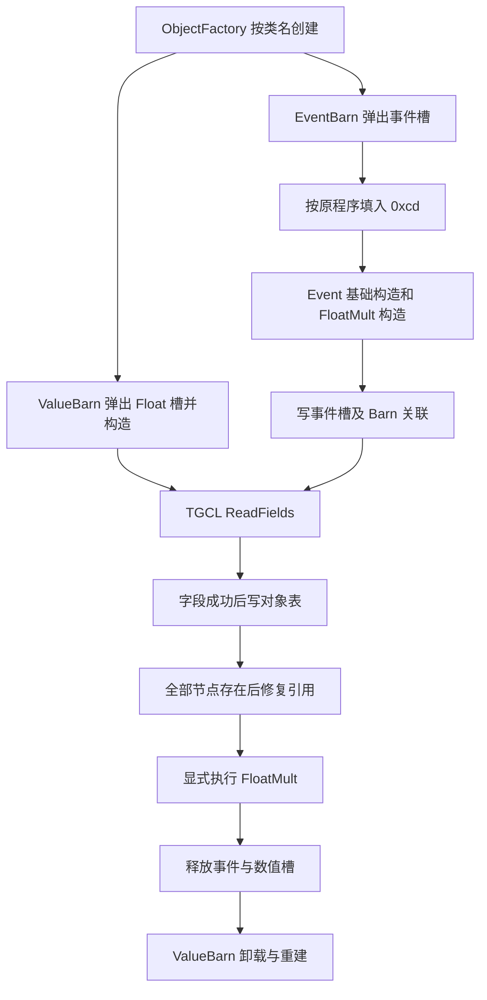

# 对象创建、字段装载与事件槽连接逆向

本轮将 Objects 的已恢复基础函数接成可核验的运行子链：ObjectFactory 分别调用 ValueBarn 和 EventBarn 创建 Float 与 FloatMult，装载保存字段，修复对象引用，执行乘法，再释放槽并恢复 ValueBarn。当前输入为已准备 metadata/成员缓存的局部对象子图。后续已接通原触发登记与自动 OnLevelLoad/Update，详见 [FloatMult 自动调度](FloatMult触发登记与自动调度逆向.md)；完整关卡仍未验收。

截至原槽/字段连接阶段，基础报告为 1,838 组、20 个命名完整原函数及 1 个装载器内引用修复区间，123,532,032 字节内存对照，零差异。FloatMult 自动连接阶段扩展至 1,989 组、33 个命名完整原函数。当前 [基础报告](object-foundation-oracle.json) 已扩展为 2,278 组、40 个命名完整原函数、161,651,548 字节对照；FloatMult/FloatAdd/SetFloat 三类共 2,435 个加载后/逐帧快照，零差异，详见 [数值事件连接](FloatAdd与SetFloat创建装载自动调度逆向.md)。新增内容包含 103 组创建/装载子链输入：97 组执行至运算/释放/重建，5 组核验原事件创建断言，1 组核验字段失败后的未发布对象表；另有 64 组直接构造与未写字段保留检查。

103 组中有 81 组覆盖三指针的全部 27 种别名与三种节点顺序，14 组来自全部实际 FloatMult 配置，另外 8 组覆盖创建失败、已加载事件释放、空槽释放及字段截断。真实配置保留 Float 值字节、autoStart 字节和原节点先后关系；引用索引映射到四节点局部表，不能称为原关卡字节直接完整装载。

## 已连接的原调用



图记录最初的显式运算连接。后续的触发模式已把唯一 ID/类型索引及原 OnLevelLoad/Update 接入；自动模式由原事件虚表执行 FloatMult，完整链路见 [自动调度图](FloatMult触发登记与自动调度逆向.md)。

| 原函数 | 地址 | 恢复内容 |
| --- | --- | --- |
| Event 构造 | `0x10032eea0` | classId/vptr、autoStart=false、Barn=null、状态与索引哨兵；保留原未写字节 |
| FloatMult placement | `0x100719090` | 先执行 Event 构造，再写自身 classId/vptr；不自行初始化三个 Float 指针 |
| EventBarn Initialize | `0x10032e4a0` | 1,280 个槽及空闲链、计数、类型表字段和卸载标志；后续自动链也核验非空类型表销毁 |
| CreateEvent<Event> | `0x100039f40` | 检查类继承、弹槽、分配、两次查询 size、填 `0xcd`、placement/cast、槽/Barn 状态写入 |
| 单事件槽释放 | `0x10032f350` | 必要时卸载，重读槽，调用析构，重读后释放，槽回空闲链 |
| 创建到字段连接 | `0x10040d0f7` / `0x10040d14f` / `0x10040d15f` | 原装载器先创建、读取对象名、读字段，再写对象表；连接适配器要求游标已指向字段，名字步骤尚未恢复 |

实现入口：[Event/FloatMult 基础构造](../src/core/event-foundation-runtime.ts)、[原事件槽基础](../src/core/native-event-barn-runtime.ts)、[创建到字段适配器](../src/core/object-field-load-runtime.ts)。它们使用现有 [ObjectFactory](../src/core/object-foundation-runtime.ts)、[ValueBarn](../src/core/value-barn-runtime.ts)、[字段与引用](../src/core/tgcl-field-runtime.ts) 和 [数值执行](../src/core/object-numeric-runtime.ts)。

## 原布局与初始化顺序

Float 是 24 字节，Object 地址与本体相同，保存值在 `+0x10`。Float 构造只写 classId，不把堆数据、回链、值或 padding 当作默认值。

FloatMult 是 80 字节，vptr 位于本体 `+0`，Object 子对象位于本体 `+8`，三个指针 a/b/output 位于本体 `+0x38/+0x40/+0x48`。ObjectFactory 返回 Object 地址，ReadFields 要通过原 metadata 转回本体再写成员。这个转换只在 FloatMult 上减 8，不能对 Float 统一处理。

Event 构造不清除所有状态。CreateEvent 模板在构造前明确填入 `0xcd`，构造后才写 loaded=0、active=1、Barn 指针；这次填充来自原函数，不推广成其他类的默认规则。

Event 注册函数 `0x100332290` 在 `0x1003324cf` 将 autoStart 的原成员偏移写为 `0xc`，随后登记 bool getter，并将 `Tool_DefaultValue` 标为 false。当前准备成员缓存据此匹配继承属性；继承字段搜索和默认缓存自动生成仍需恢复。

原装载器在 ReadFields 成功后才将 Object 写入对象表。新增截断样本在字段游标到 5、已排入一个引用后触发原断言，对象表仍未发布该节点。引用全部延迟到创建循环结束后修复，不因目标暂未创建而丢弃。

## 范围与下一层依赖

这里恢复的是通用事件槽创建模板。触发事件包装器 `0x10032ecf0` 还会写 persistence=1、分配 uint16 唯一 ID、登记每类的 uint8 类型索引；它调用类型表插入与树平衡。后续已恢复该包装器、类型树插入/平衡和非空清理，并通过原 OnLevelLoad/Update 核验真实 FloatMult 子图自动执行。原 OnLevelLoad 只对符合条件的登记触发事件处理自动启动；autoStart 字段仍必须连同登记和状态机一起验证。

真实 metadata 注册/继承转换、反射方法、size/alignment、堆内部和完整默认缓存准备仍是明确服务。释放调用在核验子图中使用已知单槽位置，完整按对象查找槽位尚待实现。完整原资源、对象名字索引、全局启动阶段、多功能类事件调度、UI/Avatar 反馈与切图仍需继续闭合。

完整类运行验收和实例完整运行验收仍为 0；本轮不提高玩法完成百分比。

最初槽/字段连接阶段的项目回归为 228 项全部通过。当前自动链新增测试与验证结果见 [自动调度说明](FloatMult触发登记与自动调度逆向.md)，原机器码报告和逐类/逐对象清单随本轮更新。

```bash
SKY_DATA=/path/to/Data npx tsx tools/object-foundation-oracle.ts /path/to/Sky
npx tsx --test tests/object-foundation-runtime.test.ts tests/tgcl-field-runtime.test.ts
```
